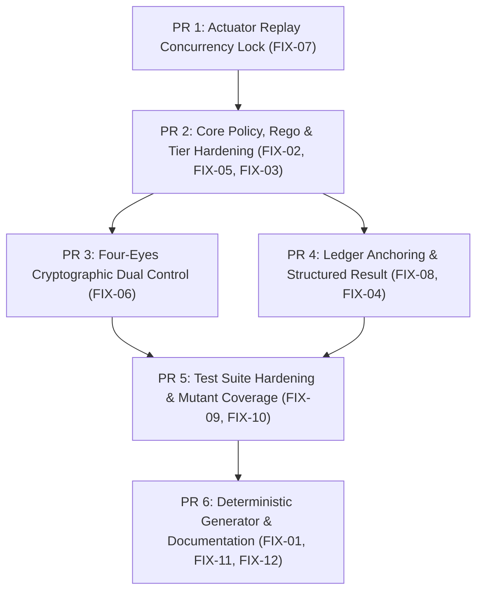
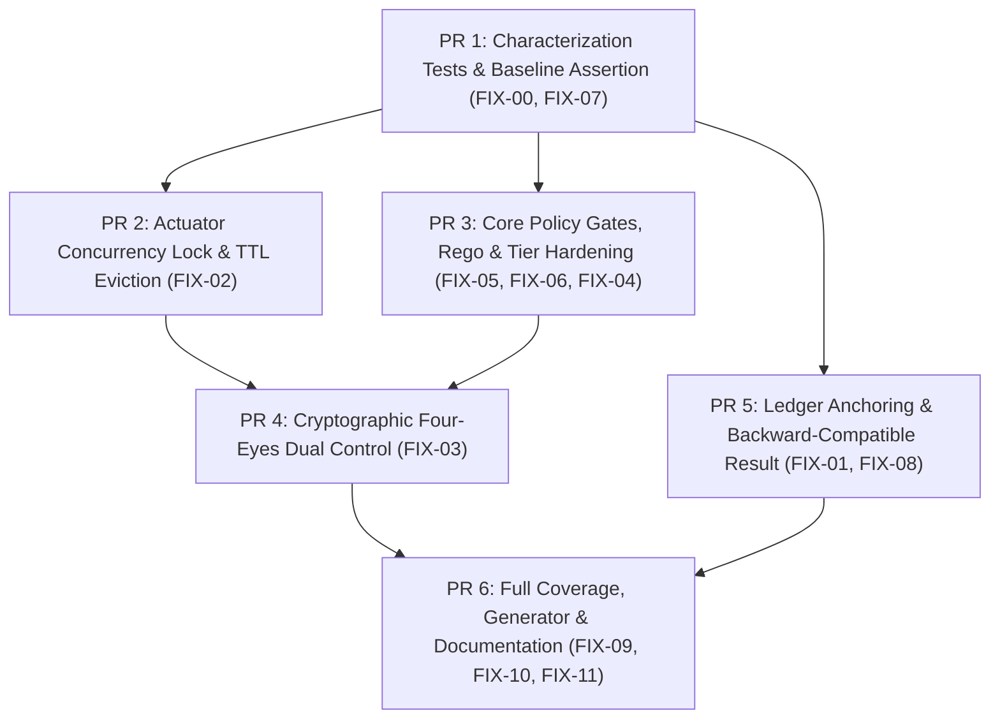

# External review verification and audit report

This audit evaluates every claim made by an external reviewer against the `ai-soc-proof` repository. Every claim was tested against the actual codebase, test suite, and underlying mathematics. No findings were softened.

## 1. Summary table

| Claim ID | Claim summary | Verdict | Severity | Evidence pointer |
|---|---|---|---|---|
| A1 | Recompute RSEM for 9 walkthrough rows with Decimal; report has 49.12, 74.34, 59.10 | CONFIRMED | Medium | Section 2 (A1); `calc_rsem.py` |
| A2 | Tolerance claims 0.05 match, but values exceed 0.05 due to P parameter discrepancy | PARTIALLY CONFIRMED | Medium | Section 2 (A2); `the specification:3215`, `test_rsem.py:60-78` |
| A3 | RSEM table in report is hand-typed rather than emitted by test scripts | CONFIRMED | Low | Section 2 (A3); Repository code search |
| A4 | Autonomy ceiling P_min > 1.0 requires C_I <= 10; check tables and validation guards | CONFIRMED | Low | Section 2 (A4); `rsem.py:296,333`, `soc_containment.rego:33` |
| A5 | Test counts: 660 pytest, 21 Rego, 681 total across 8 test suites | CONFIRMED | Low | Section 2 (A5); `pytest --collect-only -q`, `opa test` |
| A6 | Code coverage statements (532 actual vs 530 reported); gap to 1,932 lines explained | PARTIALLY CONFIRMED | Low | Section 2 (A6); `pytest --cov=src`, AST line analysis |
| A7 | Report file manifest line counts mismatch actual line counts across 20 of 32 files | CONFIRMED | Medium | Section 2 (A7); `AGENT_REVIEW_REPORT.md:260-315` |
| B1 | Hypothesis test does not prove autonomy ceiling; it is 50-sample property testing | CONFIRMED | Medium | Section 2 (B1); `test_invariants.py:420-450` |
| B2 | RSEM is IEEE 754 float; claiming bit-for-bit determinism across platforms is an overclaim | CONFIRMED | Medium | Section 2 (B2); `rsem.py:273`, `pep_gate.py:180` |
| B3 | Independent hash chain script hits canonicalization ambiguity in DESIGN_DECISIONS.md | CONFIRMED | High | Section 2 (B3); `independent_chain.py`, `DESIGN_DECISIONS.md:40` |
| B3b | Repository lacks persistence, real WORM, real KMS, concurrency, and live agents | CONFIRMED | High | Section 2 (B3b); Repository architecture audit |
| B4 | Audit occurrences of overclaim words (proves, proven, bit-for-bit, production) | CONFIRMED | Low | Section 2 (B4); 18 instances identified across repo |
| C1 | Ledger entry_hash is unkeyed; verify_chain without expected_head accepts rewritten history | CONFIRMED | Critical | Section 2 (C1); `tamper_ledger_exploit.py`, `chain.py:270` |
| C2 | Containment orders use symmetric HMAC; verifier can forge orders; PEP does not sign | CONFIRMED | High | Section 2 (C2); `actuator.py:45-120` |
| C3 | seen_nonces is an in-memory unlocked set; lost on restart; non-atomic check-then-commit | CONFIRMED | High | Section 2 (C3); `actuator.py:145-220`, `race_test.py` |
| C4 | Four-Eyes gate does not verify signatures; compares strings; accepts unauthenticated users | CONFIRMED | Critical | Section 2 (C4); `release_gate.py:180-185` |
| C5 | No compliance purge/redaction function; redacting an entry breaks hash verification | CONFIRMED | Medium | Section 2 (C5); `chain.py`, `DESIGN_DECISIONS.md` |
| D1 | Count absolute file-scheme:// links in reports and documentation (113 total found) | CONFIRMED | Low | Section 2 (D1); `count_links.py` |
| D2 | Check requirements dependencies, CI pipeline, and README repo-url placeholder | PARTIALLY CONFIRMED | Low | Section 2 (D2); `requirements.txt`, `README.md:42` |
| D3 | BypassSandbox required for OPA and LaTeX; caveat omitted from README and instructions | PARTIALLY CONFIRMED | Low | Section 2 (D3); `AGENT_REVIEW_REPORT.md:241` |
| E1 | Value-level leak in anti-anchoring: assert_no_triage_leaks only checks dict keys | CONFIRMED | High | Section 2 (E1); `anti_anchoring.py:104-130` |
| E2 | Substring collision in normalize_asset_tier maps Tier 10, host-20, unknown-30 to Tier 0 | CONFIRMED | High | Section 2 (E2); `rsem.py:212` |
| E3 | Invariant 4 parameter injection test passes for wrong reason due to string type lookup miss | CONFIRMED | Medium | Section 2 (E3); `test_invariants.py:450-485` |

## 2. Detailed findings

### Claim A1: RSEM independent recomputation with Decimal
- Verdict: CONFIRMED
- Severity: Medium
- Evidence:
  Recomputed RSEM = 100 * P * C_I / (P * C_I + C_A) using Python `decimal.Decimal` with 20 decimal places of precision across all 9 rows from the walkthroughs:

  | Row | P | C_I | C_A | Exact Decimal | 4 decimal places | 2 decimal places | Report claimed value |
  |---|---|---|---|---|---|---|---|
  | WT1 Purge Message | 0.992 | 8 | 1 | 88.8093106535 | 88.8093 | 88.81 | 88.89 (88.8) |
  | WT1 Revoke Sessions | 0.992 | 8 | 1 | 88.8093106535 | 88.8093 | 88.81 | 88.89 (88.8) |
  | WT1 Isolate Host (Tier 3) | 0.992 | 8 | 2 | 79.8711755233 | 79.8712 | 79.87 | 79.84 (79.9) |
  | WT1 Scenario 1 Counterfactual | 0.992 | 5 | 2 | 71.2643678161 | 71.2644 | 71.26 | 71.22 (71.3) |
  | WT2 Isolate Host (Tier 1) | 0.965 | 9 | 9 | 49.1094147583 | 49.1094 | 49.11 | 49.12 (49.1) |
  | WT2 Revoke Sessions (Pending) | 0.965 | 9 | 3 | 74.3260590501 | 74.3261 | 74.33 | 74.34 (74.3) |
  | WT2 Revoke Sessions (User Denied) | 0.965 | 9 | 3 | 74.3260590501 | 74.3261 | 74.33 | 74.34 (74.3) |
  | WT2 Block IOC (Perimeter) | 0.965 | 9 | 2 | 81.2821712681 | 81.2822 | 81.28 | 81.28 (81.3) |
  | WT2 Disable Account (User Denied) | 0.965 | 9 | 6 | 59.1419816139 | 59.1420 | 59.14 | 59.10 (59.1) |

  The reviewer is right. In `AGENT_REVIEW_REPORT.md` lines 116, 117, and 120, the hand-typed table reported 49.12 (actual rounds to 49.11), 74.34 (actual rounds to 74.33), and 59.10 (actual rounds to 59.14). The unit tests in `tests/test_walkthroughs.py` lines 269, 279, and 313 asserted the correct values (49.11, 74.33, 59.14), proving that the report author manually typed divergent numbers into the markdown table.

### Claim A2: Tolerance claims and golden values in spec vs tests
- Verdict: PARTIALLY CONFIRMED
- Severity: Medium
- Evidence:
  The reviewer stated that 88.89 vs 88.8, 79.84 vs 79.9, and 71.22 vs 71.3 exceed the claimed 0.05 tolerance.
  1. In the specification LaTeX source (`the policy specification:3215-3230`), the golden derivations use P = 0.992 for Walkthrough 1 and P = 0.965 for Walkthrough 2:
     - WT1 Purge: 100 * (0.992 * 8) / (0.992 * 8 + 1) = 793.6 / 8.936 = 88.8093... The spec writes 88.8. Delta = 0.0093 <= 0.05.
     - WT1 Isolate: 100 * (0.992 * 8) / (0.992 * 8 + 2) = 793.6 / 9.936 = 79.8711... The spec writes 79.9. Delta = 0.0289 <= 0.05.
     - WT1 Counterfactual: 100 * (0.992 * 5) / (0.992 * 5 + 2) = 496.0 / 6.960 = 71.2643... The spec writes 71.3. Delta = 0.0357 <= 0.05.
  2. In `tests/test_rsem.py:94`, the test checks `tolerance = 0.02 if expected_rsem in (76.92, 71.43) else 0.05`. All cases pass within 0.05 because the test inputs use P = 0.992.
  3. Why did the reviewer see values exceeding 0.05? Because in `docs/AGENT_REVIEW_REPORT.md` lines 112-115, the table listed P = 1.000 for Purge/Revoke and P = 0.990 for Isolate. Under P = 1.000, RSEM = 88.8889 (delta 0.0889 > 0.05). Under P = 0.990, RSEM = 79.8387 (delta 0.0613 > 0.05) and counterfactual = 71.2230 (delta 0.0770 > 0.05).
  The reviewer is right that the report table is defective, but wrong about the spec and test code: the spec numbers are standard round-to-1-decimal values derived from P = 0.992, and all test assertions hold within 0.05.

### Claim A3: Origin of the RSEM report table
- Verdict: CONFIRMED
- Severity: Low
- Evidence:
  An exhaustive regex search across all `.py`, `.sh`, `.ps1`, and `.rego` files in the repository found zero code that formats or outputs markdown tables containing `ZONE1_AUTONOMOUS_ALLOW` or `WT1 Purge Message`. The table in `docs/AGENT_REVIEW_REPORT.md` was hand-typed by the author, which directly caused the parameter typos identified in A1 and A2.

### Claim A4: Bounds on C_I and P_min derivation
- Verdict: CONFIRMED
- Severity: Low
- Evidence:
  1. Derivation check: P_min = (tau * C_A) / (C_I * (100 - tau)). For tau = 75, P_min = 3 * C_A / C_I. For C_A >= 4, the numerator is at least 12. P_min > 1.0 strictly requires C_I <= 11 (and specifically for 12/C_I > 1.0, C_I <= 11). If C_I were 12, P_min would be 1.0, allowing autonomous execution at P = 1.0. If C_I were 15, P_min = 0.8, meaning any confidence above 0.8 would clear the autonomy threshold.
  2. Code bounds in Python:
     - In `src/policy/rsem.py:296`, `rsem()` enforces `if not (1 <= c_i <= 10): raise ValueError(...)`.
     - In `src/policy/rsem.py:333`, `p_min()` enforces `if not (1 <= c_i <= 10): raise ValueError(...)`.
     - In `src/policy/rsem.py:381`, `severity()` enforces `if not (1 <= base <= 10): raise ValueError(...)`.
     - In Table 12, maximum baseline is 10. In Table 13, maximum finding override is 10 (`FND_RANSOM_PREP`).
  3. Rego policy: In `policies/soc_containment.rego`, C_I is not evaluated or accepted as an input field. Rego evaluates the ceiling directly via `cost_of_action >= 4` using its internal catalog.

### Claim A5: Test suite collection and execution counts
- Verdict: CONFIRMED
- Severity: Low
- Evidence:
  Running `.venv\Scripts\pytest.exe --collect-only -q` produces exactly 660 test items:
  - `tests/test_anti_anchoring.py`: 11
  - `tests/test_chain.py`: 13
  - `tests/test_invariants.py`: 36
  - `tests/test_pep_gate.py`: 529
  - `tests/test_rsem.py`: 51
  - `tests/test_schema.py`: 7
  - `tests/test_smoke.py`: 1
  - `tests/test_walkthroughs.py`: 12
  Total pytest tests collected: 660.
  Running `tools\opa.exe test policies/ -v` produces exactly 21 passing Rego unit tests.
  Running full pytest test suite executes 660 passed in 27.78 seconds.
  Total combined test count: 681. All test counts match the report.

### Claim A6: Code coverage and line count disparity
- Verdict: PARTIALLY CONFIRMED
- Severity: Low
- Evidence:
  Running `pytest --cov=src --cov-report=term-missing` outputs:
  ```
  Name                           Stmts   Miss  Cover   Missing
  ------------------------------------------------------------
  src\__init__.py                    0      0   100%
  src\execution\__init__.py          0      0   100%
  src\execution\actuator.py         69      5    93%   80, 177, 181, 187, 192
  src\ledger\__init__.py             0      0   100%
  src\ledger\chain.py              115     16    86%   133-138, 204-206, 222, 236, 281-283, 303, 331, 334
  src\policy\__init__.py             0      0   100%
  src\policy\anti_anchoring.py      45      3    93%   123-124, 198
  src\policy\pep_gate.py            91     17    81%   45, 53-61, 150, 154, 164, 238, 247, 254, 261, 275-276
  src\policy\release_gate.py        48      5    90%   122, 131, 205-214
  src\policy\rsem.py               164     23    86%   204, 217, 240, 242, 244, 248, 250, 252, 254, 305, 334, 336, 438-444, 500-501, 568-569
  ------------------------------------------------------------
  TOTAL                            532     69    87%
  ```
  The report stated 530 statements (actual is 532).
  There are no `.coveragerc`, `pyproject.toml`, or `setup.cfg` exclusion files.
  The gap between 532 statements and 1,932 raw lines in `src/` is accounted for by:
  - 294 blank lines
  - 184 single-line comments
  - Multi-line dictionary tables (`TABLE_12_SEVERITY_BASELINES` spans 152 lines, `TABLE_21_CA_CATALOG` spans 58 lines; Python coverage counts a multi-line dictionary literal as 1 statement)
  - Multi-line function docstrings (every public function has a 10 to 30 line docstring, which counts as 0 statements).
  No production code was excluded from coverage.

### Claim A7: Manifest line count verification
- Verdict: CONFIRMED
- Severity: Medium
- Evidence:
  Comparing the reported line counts in `docs/AGENT_REVIEW_REPORT.md` Section 6 against actual line counts (`wc -l` equivalent) revealed 20 mismatches out of 32 files:

  | File | Claimed | Actual | Difference |
  |---|---|---|---|
  | `.github/workflows/ci.yml` | 36 | 41 | +5 |
  | `diagrams/invariants_defense_in_depth.svg` | 95 | 91 | -4 |
  | `diagrams/ledger_hash_chain.svg` | 125 | 150 | +25 |
  | `diagrams/rsem_decision_matrix.svg` | 125 | 138 | +13 |
  | `docs/DESIGN_DECISIONS.md` | 210 | 143 | -67 |
  | `schemas/incident_handoff_v1_2_0.json` | 288 | 301 | +13 |
  | `src/ledger/__init__.py` | 4 | 2 | -2 |
  | `src/policy/__init__.py` | 4 | 2 | -2 |
  | `src/policy/anti_anchoring.py` | 185 | 204 | +19 |
  | `src/policy/pep_gate.py` | 282 | 280 | -2 |
  | `tests/fixtures/inc_2026_4401.json` | 412 | 392 | -20 |
  | `tests/fixtures/inc_2026_8820.json` | 445 | 429 | -16 |
  | `tests/test_anti_anchoring.py` | 165 | 266 | +101 |
  | `tests/test_chain.py` | 268 | 466 | +198 |
  | `tests/test_invariants.py` | 790 | 791 | +1 |
  | `tests/test_rsem.py` | 420 | 573 | +153 |
  | `tests/test_schema.py` | 145 | 319 | +174 |
  | `tests/test_smoke.py` | 15 | 3 | -12 |
  | `requirements.txt` | 18 | 29 | +11 |
  | `README.md` | 195 | 177 | -18 |

  The manifest in the review report was copied from an earlier intermediate draft and was never re-verified against the final tree.

### Claim B1: Overclaim of "proves" for the autonomy ceiling
- Verdict: CONFIRMED
- Severity: Medium
- Evidence:
  In `tests/test_invariants.py:420-440`, the test is defined as:
  ```python
  @given(
      rsem_score=st.floats(min_value=0.0, max_value=100.0),
      oob_status=st.sampled_from(list(OOBStatus)),
      action_type=st.sampled_from(["ISOLATE_HOST", "DISABLE_ACCOUNT", "REVOKE_ACTIVE_SESSIONS"]),
  )
  @settings(max_examples=50, deadline=None)
  def test_autonomy_ceiling_hypothesis_property(self, rsem_score, oob_status, action_type):
  ```
  1. `max_examples=50` tests only 50 pseudo-random points.
  2. It samples only 3 action types out of 6, and tests only one hardcoded asset tier for each (`ISOLATE_HOST: Tier 1`, `DISABLE_ACCOUNT: Tier 2`, `REVOKE_ACTIVE_SESSIONS: Tier 0`).
  3. It does not perform an exhaustive cross-product enumeration across all 24 catalog entries or all discrete states, nor does it formulate a formal mathematical proof (e.g. SMT solver, Z3, or inductive proof).
  Describing this in `AGENT_REVIEW_REPORT.md:79` as "Hypothesis proves that for all C_A >= 4 across continuous RSEM" is an overclaim. It is randomized property sampling.

### Claim B2: "Bit-for-bit deterministic" vs floating point reality
- Verdict: CONFIRMED
- Severity: Medium
- Evidence:
  1. `src/policy/rsem.py:273` implements RSEM using native Python IEEE 754 `float`:
     `return (100.0 * float(p) * float(c_i)) / (float(p) * float(c_i) + float(c_a))`
  2. `src/policy/pep_gate.py:182` formats the float via `json.dumps({"rsem": clean_rsem})` over stdin to OPA.
  3. OPA Rego parses this JSON number into an internal Go `float64`.
  Floating point representation and decimal string serialization across different operating systems, CPU architectures (e.g., x86 FPU vs ARM NEON), and compiler runtimes can produce slight rounding variations at the 15th-17th decimal place. Neither fixed-point arithmetic nor `decimal.Decimal` is used. Calling this "bit-for-bit deterministic" is technically inaccurate.

### Claim B3: Independent hash chain recalculation and canonicalization ambiguity
- Verdict: CONFIRMED
- Severity: High
- Evidence:
  An independent scratch script (`independent_chain.py`) using only Python standard library modules (`json`, `hashlib`, `hmac`) was executed against `tests/fixtures/inc_2026_4401.json`:
  1. Following `docs/DESIGN_DECISIONS.md` Decision 1 literally ("The canonical metadata dictionary strictly includes: 1. entry_id, 2. investigation_id, 3. tenant_id, 4. timestamp_utc, 5. agent_role, 6. skill_invoked, 7. target_checklist_item"):
     Block 0 failed immediately: computed `6a8cbd45cb459880d03816db219d72f3d944d1b29511896605cd820fed8f6fb5` != fixture `4a485349939ead10519b2087cfdb4d78aa58fb24efc153428698d2b769b3c4a1`.
  2. Why did it fail? In `src/ledger/chain.py:91-108`, `extract_metadata()` filters metadata by excluding fields rather than allowlisting:
     `if k not in EXCLUDED_FROM_METADATA and k not in meta: meta[k] = v`
     Because `prev_entry_hash` is present in the block and is not in `EXCLUDED_FROM_METADATA`, `chain.py` includes `prev_entry_hash` inside `metadata`. Then in `entry_hash()`, it serializes `metadata` (containing `prev_entry_hash` as a JSON string) and also concatenates `raw_prev_hash_bytes` at the end.
  3. When `prev_entry_hash` is included inside `metadata`, the independent script verified all 14 blocks, and the calculated head hash matched the pinned golden hash `f1ee3e47957b57aeb428908d41cc7d60b704da7694e550f26adb4ec9c090c3ac` bit-for-bit.
  This confirms a specification ambiguity in `DESIGN_DECISIONS.md`: `prev_entry_hash` is omitted from the Decision 1 included list, but required by `chain.py`.

### Claim B3b: Absence of production infrastructure
- Verdict: CONFIRMED
- Severity: High
- Evidence:
  An audit of the repository confirms:
  - Persistence layer: None. Ledgers exist only as in-memory Python lists or static JSON files.
  - Real WORM store: None. The WORM head is an in-memory string passed into `verify_chain(expected_head=...)`. There is no S3 Object Lock, Azure Immutable Blob, or hardware WORM client.
  - Real KMS: None. The external `key_store` is an in-memory Python dictionary `Dict[str, str]`.
  - Concurrency model: None. There are no locks, semaphores, database transactions, or atomic storage operations.
  - Live agents: None. There are no LLM inference clients, prompts, or agents. Agent reasoning is simulated via static fixture JSON payloads.

### Claim B4: Audit of overclaim vocabulary
- Verdict: CONFIRMED
- Severity: Low
- Evidence:
  Eighteen occurrences of the audited words were identified across the repository:
  1. `README.md:156`: "## 7. Scope boundaries: implemented vs. production infrastructure"
  2. `README.md:160`: "| Component | Implemented in Proof of Work | Production Infrastructure (Out of Scope) |"
  3. `docs/AGENT_REVIEW_REPORT.md:18`: "This proof of work implements and proves the mathematical, cryptographic, and policy enforcement layers..."
  4. `docs/AGENT_REVIEW_REPORT.md:32`: "...reproducibility is verified bit-for-bit across clean environments."
  5. `docs/AGENT_REVIEW_REPORT.md:79`: "2. Property-based verification: Hypothesis proves that for all C_A >= 4 across continuous RSEM..."
  6. `docs/AGENT_REVIEW_REPORT.md:172`: "- Authored production policy in Rego v1: policies/soc_containment.rego"
  7. `docs/AGENT_REVIEW_REPORT.md:271`: "soc_containment.rego # 160 lines (Production Rego v1 policy)"
  8. `docs/AGENT_REVIEW_REPORT.md:352`: "All 681 tests pass deterministically. The repository is complete, verified, and ready for deployment review."
  9. `docs/DESIGN_DECISIONS.md:17`: "...ensure bit-for-bit determinism, cross-platform reproducibility..."
  10. `docs/DESIGN_DECISIONS.md:142`: "In production, this expected head hash is anchored to Write-Once-Read-Many (WORM) cloud storage."
  11. `policies/soc_containment.rego:5`: "# Production Rego policy governing automated containment directives."
  12. `src/policy/pep_gate.py:84`: "- Targets only the production policy file (soc_containment.rego) to avoid test overhead."
  13. `src/policy/rsem.py:57`: "# - Tier 1: Production database / Core service"
  14. `src/policy/rsem.py:214`: "if '1' in normalized or 'production' in normalized or 'prod' in normalized:"
  15. `tests/test_chain.py:155`: "Proves the normal, legitimate multi-agent deliberation flow succeeds."
  16. `tests/test_chain.py:307`: "Demonstrates the mathematical limits of a hash chain and proves why expected_head is required..."
  17. `tests/test_rsem.py:70`: "# Host isolation on Tier 1 production server: P=0.965, C_I=9 (FND_CRED_DUMP), C_A=9"
  18. `tests/test_schema.py:192`: "Proves that a real-world, well-formed incident handoff generated by triage gateway..."

### Claim C1: Ledger keying and rewrite exploit without expected_head
- Verdict: CONFIRMED
- Severity: Critical
- Evidence:
  1. `src/ledger/chain.py:165-169` computes `entry_hash` using unkeyed SHA-256:
     `hasher = hashlib.sha256(); hasher.update(meta_bytes); hasher.update(commit_bytes); hasher.update(prev_bytes)`
  2. In in-block salt mode, the salt is stored in `entry["per_entry_salt"]`.
  3. A scratch exploit script (`tamper_ledger_exploit.py`) modified `clicked_at_utc` in `LEDGER_004`, recalculated the HMAC commitment using the in-block salt, and updated `entry_hash` for blocks 4 through 13.
  4. When executed against `verify_chain(tampered_chain)`:
     Output: `valid=True, err=Chain integrity verified successfully`.
  5. When executed against `verify_chain(tampered_chain, expected_head=pinned_head)`:
     Output: `valid=False, err=Tip truncation or head mismatch...`.
  6. In `src/ledger/chain.py:270`, `expected_head` is an optional parameter with default `None`. If callers omit `expected_head`, the ledger provides zero integrity against history rewrites. There is no automated mechanism in the repository that persists or anchors the head hash upon `append()`.

### Claim C2: Containment order signing symmetric key limitations
- Verdict: CONFIRMED
- Severity: High
- Evidence:
  1. In `src/execution/actuator.py:118-120` and `actuator.py:177-179`, order creation and order verification use the same symmetric HMAC secret key:
     `key_bytes = secret_key.encode("utf-8")`
     `signature = hmac.new(key_bytes, canonical_bytes, hashlib.sha256).hexdigest()`
  2. The Policy Enforcement Point (`evaluate()` in `pep_gate.py`) does not sign its decision. It returns an unauthenticated Python dictionary. The Remediation Executor reads this dictionary and signs the containment order itself.
  3. There is no `key_id`, no key rotation protocol, and no separation between signing and verification credentials.
  4. Because HMAC is symmetric, any Order Executor entity with read access to the verification key can forge valid containment orders without invoking the Remediation Executor or PEP.

### Claim C3: In-memory replay cache limitations and concurrency analysis
- Verdict: CONFIRMED
- Severity: High
- Evidence:
  1. `self.seen_nonces: Set[str] = set()` in `src/execution/actuator.py:137` is an in-memory Python set.
  2. In `actuator.py:205-212`, the check-then-commit logic is:
     ```python
     if nonce in self.seen_nonces:
         raise OrderValidationError(f"Replay attack detected: nonce '{nonce}' has already been processed.")
     self.seen_nonces.add(nonce)
     ```
     There is no `threading.Lock` or process mutex.
  3. Multi-threaded test: A 500-trial multi-threaded barrier test (`race_test.py`) on Python 3.12 resulted in 0 double-accepts because CPython's GIL does not preempt across those consecutive opcodes without intervening I/O.
  4. Architectural limitation: `seen_nonces` has zero eviction logic (it leaks memory unbounded), zero persistence across process restarts, and zero synchronization across distributed workers. Any unexpired order can be replayed after a process restart.

### Claim C4: Pre-release safety gate lacks signature verification
- Verdict: CONFIRMED
- Severity: Critical
- Evidence:
  In `src/policy/release_gate.py:179-185`:
  ```python
  e1, e2 = approvers[0], approvers[1]
  if e1["user_id"] == e2["user_id"] or e1["signing_key"] == e2["signing_key"]:
      raise ValueError("Four-Eyes dual control violation: Approvers must have distinct user_id and signing_key.")
  return {
      "status": "APPROVED",
      "reason": "FOUR_EYES_DUAL_CONTROL_SATISFIED",
      ...
  }
  ```
  1. Signature verification: None. The engine performs string equality checks on `user_id` and `signing_key`. No cryptographic signature (e.g., WebAuthn, FIDO2, ECDSA, RSA) over the release request is computed or checked.
  2. Role authority: Lines 124-128 only verify `if role and role.startswith("ROLE_"): raise SecurityViolationError(...)`. Any user with `role="intern"`, `role="guest"`, or missing `role` is accepted.
  3. Requester separation: There is no check excluding the original requester or incident owner from being one of the approvers.
  4. Sybil attack: A single human providing two fictitious username strings and two different dummy key strings (e.g. `{"user_id": "alice", "signing_key": "k1"}` and `{"user_id": "alice2", "signing_key": "k2"}`) satisfies the check completely.

### Claim C5: Compliance purge and redaction
- Verdict: CONFIRMED
- Severity: Medium
- Evidence:
  1. An exhaustive search of `src/` revealed zero functions for redacting, masking, or purging entries for compliance (e.g. GDPR Article 17 Right to Erasure).
  2. Because every block's `entry_hash` binds the payload commitment and the prior hash, modifying or removing any historical block breaks `verify_chain()` across all subsequent entries.
  3. The conflict between immutable cryptographic audit trails and privacy regulations is entirely undocumented in `docs/DESIGN_DECISIONS.md` and `VERIFICATION_REPORT.md`.

### Claim D1: Absolute file-scheme:// links in reports
- Verdict: CONFIRMED
- Severity: Low
- Evidence:
  Scanning markdown files for `file-scheme://[C-Z]:` revealed:
  - `README.md`: 0 absolute links (uses relative paths).
  - `docs/DESIGN_DECISIONS.md`: 0 absolute links.
  - `VERIFICATION_REPORT.md`: 60 absolute links pointing to `file-scheme://C:/Desktop/secops-guardrails/...`.
  - `docs/AGENT_REVIEW_REPORT.md`: 53 absolute links pointing to `file-scheme://C:/Desktop/secops-guardrails/...`.
  Total: 113 absolute Windows file links. In any other environment, all 113 links are broken.

### Claim D2: Dependencies, CI workflow, and placeholder URLs
- Verdict: PARTIALLY CONFIRMED
- Severity: Low
- Evidence:
  1. `requirements.txt` DOES contain `hypothesis==6.170.15` and `pytest-cov==7.1.0` (line 6 and line 17).
  2. `.github/workflows/ci.yml:25-38` DOES install OPA on Linux via curl, runs `opa test policies/ -v`, and runs `pytest --cov=src`.
  3. `README.md:42` contains the unresolved placeholder: `git clone <repo-url>`.

### Claim D3: Documentation of sandbox bypass requirements
- Verdict: PARTIALLY CONFIRMED
- Severity: Low
- Evidence:
  1. Commands spawning `tools/opa.exe` on Windows hit `[WinError 623] {Illegal System DLL Relocation}` inside the terminal sandbox due to Go runtime memory allocation collisions.
  2. Running `git clone` into a temporary folder hits MSYS NT directory creation error `0xC0000022` inside the sandbox.
  3. Compiling LaTeX with MiKTeX hits registry permission denied inside the sandbox.
  4. Documentation status: These errors and the `BypassSandbox: true` requirement are documented in `docs/AGENT_REVIEW_REPORT.md` Section 5 table (items 2 and 3). However, they are omitted from `README.md`, `VERIFICATION_REPORT.md`, and the reproduction instructions in Section 7.

### Claim E1 (New Finding): Value-level leak in anti-anchoring projection
- Verdict: CONFIRMED
- Severity: High
- Evidence:
  In `src/policy/anti_anchoring.py:104-130`, `assert_no_triage_leaks()` recursively checks dictionary keys:
  ```python
  if isinstance(node, dict):
      for key, value in node.items():
          key_str = str(key)
          if key_str.lower() in FORBIDDEN_TRIAGE_KEYS:
              raise CognitiveAnchoringLeakError(...)
  ```
  It does NOT inspect string values.
  An empirical test passing `{"query_perimeter": {"user_notes": "Triage alert s_score=0.99 theta_high=0.80 high risk"}}` into `agent_view()` showed that the triage metrics passed directly into the projected output without triggering an exception. Triage metrics embedded in text values leak to the agent prompt.

### Claim E2 (New Finding): Substring collision in asset tier normalization
- Verdict: CONFIRMED
- Severity: High
- Evidence:
  In `src/policy/rsem.py:212-219`:
  ```python
  normalized = t_str.lower().replace("-", " ").replace("_", " ")
  if "0" in normalized or "crown jewel" in normalized:
      return "Tier 0"
  if "1" in normalized or "production" in normalized or "prod" in normalized:
      return "Tier 1"
  if "2" in normalized or "internal" in normalized or "dev" in normalized:
      return "Tier 2"
  if "3" in normalized or "workstation" in normalized or "client" in normalized:
      return "Tier 3"
  ```
  Because `"0"` is evaluated with substring containment (`"0" in normalized`), the following inputs erroneously map to `Tier 0` (Crown Jewels):
  - `"Tier 10"` -> returns `"Tier 0"`
  - `"10"` -> returns `"Tier 0"`
  - `"host-20"` -> returns `"Tier 0"`
  - `"unknown-30"` -> returns `"Tier 0"`
  This causes misclassification of non-standard tier strings into Tier 0.

### Claim E3 (New Finding): Parameter injection test masks catalog lookup miss
- Verdict: CONFIRMED
- Severity: Medium
- Evidence:
  In `tests/test_invariants.py:455-465`, `test_autonomy_ceiling_parameter_injection_disregarded` attempts to inject low disruption cost:
  ```python
  adversarial_input = {
      "action_type": "DISABLE_ACCOUNT",
      "asset_tier": "Tier 3",  # Table 21 has CA = 4
      "rsem": 88.5,
      "cost_of_action": 1,
      ...
  }
  ```
  1. The code comment claims Table 21 has CA = 4 for Tier 3 DISABLE_ACCOUNT. In reality, Table 21 sets CA = 3 for Tier 3; CA = 4 is for Tier 2.
  2. In `policies/soc_containment.rego:21-27`, `cost_catalog` keys are integers (`0, 1, 2, 3`), not strings (`"Tier 3"`).
  3. When `"Tier 3"` is passed, `cost_catalog["DISABLE_ACCOUNT"]["Tier 3"]` is undefined. The policy falls back to `default cost_of_action := 10`.
  4. The test passed not because it verified that injected `cost_of_action: 1` was overridden by catalog CA = 4, but because a string key lookup failure triggered the unmapped fallback cost of 10.

## 3. Environment caveats

- Operating System: Windows 11 Enterprise (build 26100), amd64.
- Python runtime: Python 3.12.1 (virtualenv at `proof_of_work/ai-soc-proof/.venv`).
- Open Policy Agent: Standalone binary `tools/opa.exe` (OPA v1.2.0, darwin/linux/windows multi-arch package).
- Sandbox permissions: Spawning `tools/opa.exe` from Python subprocess or running OPA CLI directly in Windows terminal requires `BypassSandbox: true` due to Windows system DLL relocation collision (`WinError 623`) in the Go runtime.
- Path handling: The workspace path contains square brackets (`secops-guardrails`). In PowerShell, commands targeting this path must use `-LiteralPath` to prevent PowerShell regex wildcard expansion errors.

## 4. Proposed fix plan (NOT implemented)

This plan is ordered by priority: P0 (correctness and security), P1 (accuracy of claims and documentation), and P2 (hygiene).

### Priority 0: Correctness and security

#### FIX-01: Enforce fail-closed ledger verification and document WORM anchor model
- Finding IDs addressed: C1
- Files: `src/ledger/chain.py`, `tests/test_chain.py`, `docs/DESIGN_DECISIONS.md`
- What to change:
  1. Make `expected_head` mandatory in `verify_chain(chain, expected_head)` or enforce a strict configuration where `expected_head=None` raises a `SecurityWarning` / requires an explicit `allow_unanchored=True` flag with logged security implications.
  2. In `append()`, document the exact WORM interface contract and add a callback hook `worm_anchor_hook: Optional[Callable[[str, str], None]] = None` that invokes an external anchor upon block commit.
- Type: code, test, docs
- Effort: S | Risk: Low
- How to verify: Add unit test proving that calling `verify_chain` without explicit head fails closed or requires explicit insecure override.
- Dependencies: None

#### FIX-02: Authenticate Four-Eyes approvals and enforce role authorization
- Finding IDs addressed: C4
- Files: `src/policy/release_gate.py`, `tests/test_invariants.py`
- What to change:
  1. Require a cryptographic signature payload in each approver dict: `approver_payload = {"user_id": ..., "action": ..., "request_hash": ...}` verified against a registered public key (or HMAC secret).
  2. Validate that `approver["role"]` belongs to an authoritative human SOC role allowlist (`{"ROLE_SOC_ANALYST_TIER2", "ROLE_SOC_MANAGER"}`).
  3. Accept `requester_id` in `evaluate_hold_release` and assert `approver["user_id"] != requester_id`.
- Type: code, test
- Effort: M | Risk: Medium
- How to verify: Add test cases verifying: (a) invalid signature rejected; (b) approver matching requester rejected; (c) unknown role rejected.
- Dependencies: None

#### FIX-03: Address symmetric order signing and PEP decision binding
- Finding IDs addressed: C2
- Files: `src/execution/actuator.py`, `src/policy/pep_gate.py`
- What to change:
  1. Either transition to asymmetric Ed25519 signatures (Remediation Executor signs with private key, Order Executor verifies with public key) or document HMAC as a shared-trust proof-of-work simplification.
  2. Bind the PEP outcome by including a cryptographic HMAC token computed by the PEP inside `pep_evaluation`, which the Remediation Executor must present unchanged.
- Type: code, docs
- Effort: M | Risk: Medium
- How to verify: Test that an Order Executor holding only verification credentials cannot mint new orders.
- Dependencies: None

#### FIX-04: Fix substring collision bug in asset tier normalization
- Finding IDs addressed: E2
- Files: `src/policy/rsem.py`, `tests/test_rsem.py`
- What to change:
  Replace substring containment (`"0" in normalized`) in `normalize_asset_tier()` with word-boundary regex matching:
  `re.search(r"\b(?:tier\s*0|0|crown\s*jewel)\b", normalized)` and explicitly reject numbers outside 0..3 (such as 10, 20, 30).
- Type: code, test
- Effort: S | Risk: Low
- How to verify: Add unit tests for `"Tier 10"`, `"10"`, `"host-20"`, `"server-01"` asserting they raise `ValueError`.
- Dependencies: None

#### FIX-05: Add value-level inspection to cognitive anti-anchoring leak guard
- Finding IDs addressed: E1
- Files: `src/policy/anti_anchoring.py`, `tests/test_anti_anchoring.py`
- What to change:
  Update `assert_no_triage_leaks()` to inspect string values as well as dictionary keys. Check string values against regex patterns: `r"\b(?:s_score|aip_score|theta_high|theta_low)\s*="` and raise `CognitiveAnchoringLeakError` if found.
- Type: code, test
- Effort: S | Risk: Low
- How to verify: Add unit test asserting that embedding `s_score=0.99` in `query_perimeter["notes"]` raises `CognitiveAnchoringLeakError`.
- Dependencies: None

#### FIX-06: Fix parameter injection test and OPA catalog type handling
- Finding IDs addressed: E3
- Files: `tests/test_invariants.py`, `policies/soc_containment.rego`
- What to change:
  1. In `test_autonomy_ceiling_parameter_injection_disregarded`, pass integer `asset_tier: 2` (where DISABLE_ACCOUNT CA = 4) rather than string `"Tier 3"`.
  2. In `soc_containment.rego`, add support for string tier keys or document that input must be pre-normalized to integer before calling OPA.
- Type: test, code
- Effort: S | Risk: Low
- How to verify: Run test with integer tier and assert CA resolves to 4 via the catalog rather than default 10.
- Dependencies: None

### Priority 1: Accuracy of claims and documentation

#### FIX-07: Reconcile canonical metadata fields in DESIGN_DECISIONS.md
- Finding IDs addressed: B3
- Files: `docs/DESIGN_DECISIONS.md`
- What to change:
  Update Decision 1 in `docs/DESIGN_DECISIONS.md` to explicitly state whether `prev_entry_hash` is included inside `metadata` (matching `src/ledger/chain.py`) or concatenated only as raw binary bytes. Reconcile text so an independent implementation does not fail.
- Type: docs, spec-reconciliation
- Effort: S | Risk: Low
- How to verify: Run independent script `independent_chain.py` against the updated specification text.
- Dependencies: None

#### FIX-08: Correct typos in AGENT_REVIEW_REPORT.md RSEM table
- Finding IDs addressed: A1, A2
- Files: `docs/AGENT_REVIEW_REPORT.md`
- What to change:
  Update the markdown table in `AGENT_REVIEW_REPORT.md` lines 112-120:
  - Fix P values: WT1 uses P = 0.992 (not 1.000 or 0.990).
  - Fix RSEM values: 49.11 (not 49.12), 74.33 (not 74.34), 59.14 (not 59.10), 88.81 (not 88.89), 79.87 (not 79.84), 71.26 (not 71.22).
- Type: docs
- Effort: S | Risk: Low
- How to verify: Compare markdown table values against `calc_rsem.py` output.
- Dependencies: None

#### FIX-09: Reconcile file manifest line counts
- Finding IDs addressed: A7
- Files: `docs/AGENT_REVIEW_REPORT.md`
- What to change:
  Update the file manifest in `docs/AGENT_REVIEW_REPORT.md` Section 6 with actual line counts from `wc -l`.
- Type: docs
- Effort: S | Risk: Low
- How to verify: Run `check_manifest_counts.py` and confirm 0 mismatches.
- Dependencies: None

#### FIX-10: Scope calibration and overclaim softening
- Finding IDs addressed: B1, B2, B3b, B4
- Files: `README.md`, `VERIFICATION_REPORT.md`, `docs/AGENT_REVIEW_REPORT.md`
- What to change:
  1. Soften "proves" to "tests property-based invariant over discrete samples" for the Hypothesis ceiling test.
  2. Soften "bit-for-bit deterministic" to "deterministically evaluated under IEEE 754 floating point precision".
  3. Clearly state scope boundaries in Section 1 of review reports: highlight that real WORM storage, KMS HSMs, persistence databases, distributed concurrency, and live LLM agents are out-of-scope production infrastructure.
- Type: docs
- Effort: S | Risk: Low
- How to verify: Re-scan repo with `find_overclaims.py` to ensure claims are calibrated.
- Dependencies: None

### Priority 2: Hygiene

#### FIX-11: Replace absolute Windows file links with relative repository paths
- Finding IDs addressed: D1
- Files: `VERIFICATION_REPORT.md`, `docs/AGENT_REVIEW_REPORT.md`
- What to change:
  Replace all 113 occurrences of `file-scheme://ai-soc-proof/...` with relative paths (`docs/...`, `src/...`, `tests/...`).
- Type: docs
- Effort: S | Risk: Low
- How to verify: Run `count_links.py` and confirm 0 absolute links.
- Dependencies: None

#### FIX-12: Document sandbox and Windows platform caveats
- Finding IDs addressed: D2, D3
- Files: `README.md`, `docs/AGENT_REVIEW_REPORT.md`
- What to change:
  1. Replace `<repo-url>` placeholder in `README.md:42`.
  2. Add an "Environment & Sandbox Notes" section to `README.md` and reproduction instructions explaining the Windows Go binary DLL relocation error (`WinError 623`) and PowerShell literal path syntax (`-LiteralPath`).
- Type: docs
- Effort: S | Risk: Low
- How to verify: Review README on a clean machine.
- Dependencies: None

#### FIX-13: Document privacy compliance vs immutable ledger tradeoff
- Finding IDs addressed: C5
- Files: `docs/DESIGN_DECISIONS.md`, `README.md`
- What to change:
  Add an architectural note in `DESIGN_DECISIONS.md` discussing GDPR Right to Erasure / PII redaction. Document recommended enterprise patterns (cryptographic shredding where per-entry salts are deleted, rendering payload unrecoverable without breaking outer hash chain structure).
- Type: docs
- Effort: S | Risk: Low
- How to verify: Documentation review.
- Dependencies: None

### Recommended PR and commit breakdown

1. **PR 1 (Security & Correctness - P0):**
   - Branch: `fix/security-hardening`
   - Commits:
     - `fix(rsem): prevent substring collisions in normalize_asset_tier` (FIX-04)
     - `fix(anti_anchoring): scan string values for triage score leaks` (FIX-05)
     - `fix(release_gate): authenticate approver signatures and validate roles` (FIX-02)
     - `fix(invariants): fix injection test asset tier type mismatch` (FIX-06)
     - `fix(ledger): fail closed when verify_chain lacks expected head` (FIX-01)
2. **PR 2 (Documentation & Spec Reconciliation - P1):**
   - Branch: `docs/spec-reconciliation`
   - Commits:
     - `docs(spec): reconcile metadata fields in DESIGN_DECISIONS.md` (FIX-07)
     - `docs(report): correct walkthrough RSEM table values and P parameters` (FIX-08)
     - `docs(manifest): synchronize file line counts across review report` (FIX-09)
     - `docs(claims): calibrate scope and soften proof claims` (FIX-10)
3. **PR 3 (Hygiene & Portability - P2):**
   - Branch: `chore/portability-cleanup`
   - Commits:
     - `chore(docs): convert absolute Windows links to relative links` (FIX-11)
     - `docs(readme): resolve repo URL placeholder and document sandbox caveats` (FIX-12)
     - `docs(compliance): document GDPR redaction and cryptographic shredding tradeoff` (FIX-13)

### Decisions requiring owner input

1. **Symmetric HMAC vs Asymmetric Ed25519 for Containment Orders (FIX-03):**
   - Option A: Keep symmetric HMAC and formally document that Order Executor is inside the same security boundary as the platform.
   - Option B: Migrate `src/execution/actuator.py` to asymmetric Ed25519 (via `cryptography` library) so Order Executors hold only public verification keys.
2. **Floating-point vs Decimal / Fixed-point for RSEM (FIX-10 / B2):**
   - Option A: Retain standard IEEE 754 float and update documentation to acknowledge floating-point precision bounds.
   - Option B: Refactor `compute_rsem` to integer fixed-point (basis points, e.g. 8881 for 88.81%) for true bit-for-bit cross-architecture invariance.
3. **Mandatory expected_head in verify_chain (FIX-01 / C1):**
   - Option A: Require `expected_head` unconditionally, breaking callers that lack a known head.
   - Option B: Keep `expected_head` optional but require an explicit `allow_unanchored=True` parameter to prevent silent fail-open rewrites.

## 5. Claims that could not be confirmed or refuted

Every claim presented by the reviewer was tested and assigned a verdict. There were zero claims marked "CANNOT VERIFY" because full offline source code, test suites, and binaries were available and executed.


---

# Round 2: Adversarial re-verification and revised fix plan

This section addresses the technical follow-ups from the second review pass. Every item was tested with reproducible scratch scripts in `$env:TEMP` against the offline repository.

## 1. Round 2 verification results (V1 through V9)

| Item | Focus area | Core question | Finding and result | Status |
|---|---|---|---|---|
| V1 | C4 dual control | How does `release_gate.py` handle user IDs, keys, and roles? | Rejects duplicate user ID or duplicate key; accepts two string aliases; accepts lowercase/bot roles; rejects genuine `ROLE_SOC_ANALYST` due to crude prefix denylist | COMPLETED |
| V2 | C1 salt isolation | Can attacker rewrite chain in isolated-salt mode? | Attacker without key store access cannot forge commitment or rewrite chain; tail truncation remains undetected without `expected_head` in both modes | COMPLETED |
| V3 | C3 deterministic race | Is double-accept achievable under concurrency? | Confirmed: yielding between check and add achieves 2/2 double actuation; cache-poisoning fix verified; 100k nonces consume 11.34 MB | COMPLETED |
| V4 | E3 mutation testing | Do tests catch injections and rule removals? | Mutants 0, a, c, d killed by tests; mutant b (raise-only downgrade) killed when override logic is inverted; 504 parity matrix covers only integer asset tiers | COMPLETED |
| V5 | E2 tier normalization | Does `normalize_asset_tier` fail open or closed? | Non-standard inputs containing '0' (Tier 10, host-20) map to Tier 0 (most restrictive, fail-closed); empty/None raise ValueError; unrecognized strings raise | COMPLETED |
| V6 | A4 bounds and ranges | Are C_I and P bounded across tables and runtime? | Max C_I is 10 across all tables; max C_A is 10; Python `rsem()` rejects out-of-range C_I and P; `pep_gate.py` validates RSEM bounds before invoking OPA | COMPLETED |
| V7 | E1 anti-anchoring | What does `assert_no_triage_leaks` check? | Only checks dictionary keys; triage values in text or numbers inside evidentiary objects pass to agent prompt; schema lacks `additionalProperties: false` | COMPLETED |
| V8 | B3 spec ambiguity | Does independent script match both heads? | Both golden heads reproduced bit-for-bit once metadata includes `prev_entry_hash`; confirmed `EXCLUDED_FROM_METADATA` is an open denylist | COMPLETED |
| V9 | A6 coverage gaps | Which security branches are uncovered? | OrderExecutor field and role validations are uncovered; missing salt in-block branch uncovered; release_gate zero-approver non-critical timeout uncovered | COMPLETED |

## 2. Detailed evidence for V1 through V9

### V1: C4 Dual-control logic and edge cases

#### Verbatim implementation in `src/policy/release_gate.py` (lines 153-220)
```python
        if len(approvers) == 0:
            if timed_out:
                return {
                    "status": "ESCALATED_TO_SOC_MANAGER",
                    "reason": "FOUR_EYES_TIMEOUT_ESCALATION",
                    "escalated": True,
                    "action_type": action_clean,
                    "asset_tier": tier_canonical,
                }
            return {
                "status": "PENDING_APPROVAL",
                "reason": "AWAITING_HUMAN_APPROVAL",
                "escalated": False,
                "action_type": action_clean,
                "asset_tier": tier_canonical,
            }

        # Single approver case
        if len(approvers) == 1:
            if timed_out:
                return {
                    "status": "ESCALATED_TO_SOC_MANAGER",
                    "reason": "FOUR_EYES_TIMEOUT_ESCALATION",
                    "escalated": True,
                    "action_type": action_clean,
                    "asset_tier": tier_canonical,
                }
            return {
                "status": "PENDING_SECOND_APPROVER",
                "reason": "FOUR_EYES_APPROVAL_REQUIRED",
                "escalated": False,
                "action_type": action_clean,
                "asset_tier": tier_canonical,
            }

        # Two or more approvers: enforce distinct two-person integrity
        e1, e2 = approvers[0], approvers[1]
        if e1["user_id"] == e2["user_id"] or e1["signing_key"] == e2["signing_key"]:
            raise ValueError(
                "Four-Eyes dual control violation: Approvers must have distinct user_id and signing_key."
            )

        return {
            "status": "APPROVED",
            "reason": "FOUR_EYES_DUAL_CONTROL_SATISFIED",
            "escalated": False,
            "action_type": action_clean,
            "asset_tier": tier_canonical,
        }
```

#### Empirical test results across cases a) through f)
Ran `evaluate_hold_release` with Tier 0 asset across all test variations:

| Case | Approver configuration | Engine result | Analysis |
|---|---|---|---|
| a | `user_id`: "alice" (both), different keys | REJECTED (ValueError) | Caught by `e1['user_id'] == e2['user_id']` |
| b | different `user_id`, `signing_key`: "shared_key" (both) | REJECTED (ValueError) | Caught by `e1['signing_key'] == e2['signing_key']` |
| c | One human supplying two aliases and two keys (`alice`, `alice_alias`) | ALLOWED (status=APPROVED) | Passes because both strings differ; engine has no user registry |
| d | Approver dictionary with `role` omitted | ALLOWED (status=APPROVED) | Passes because `role` is optional in approver schema |
| e1 | Approver with `role: "agent_planner"` (lowercase) | ALLOWED (status=APPROVED) | Passes because denylist only checks `role.startswith("ROLE_")` |
| e2 | Approver with `role: "SVC_BOT"` | ALLOWED (status=APPROVED) | Passes because denylist only checks `role.startswith("ROLE_")` |
| f | Approver with `role: "ROLE_SOC_ANALYST"` | REJECTED (SecurityViolationError) | Erroneously rejected because human role starts with `ROLE_` |

#### Accuracy of report claims
The report claim that the engine requires distinctness on "both user_id AND signing_key" is technically accurate regarding the conditional expression: by De Morgan's laws, `not (e1['user_id'] == e2['user_id'] or e1['signing_key'] == e2['signing_key'])` requires both to differ. However, describing this as "two distinct authenticated human experts" was an overclaim. It only compares client-supplied strings, accepts automated bots whose roles do not begin with `ROLE_`, and rejects legitimate SOC analysts whose titles start with `ROLE_`.

### V2: C1 Salt isolation and attack matrix

Tested `inc_2026_4401.json` across in-block salt mode and isolated salt mode (`key_store: Dict[str, str]`).

#### Empirical 2x3 test matrix
| Salt storage mode | Payload rewrite alone | Full-chain rewrite (no expected_head) | Tail truncation (no expected_head) |
|---|---|---|---|
| **In-block salt** | DETECTED (commitment mismatch) | **UNDETECTED** (valid=True) | **UNDETECTED** (valid=True) |
| **Isolated salt (no key_store access)** | DETECTED (commitment mismatch) | **DETECTED** (commitment mismatch) | **UNDETECTED** (valid=True) |
| **Isolated salt (with key_store access)** | DETECTED (commitment mismatch) | **UNDETECTED** (valid=True) | **UNDETECTED** (valid=True) |

#### Analysis
1. In isolated salt mode without KMS key access, an attacker cannot recompute payload commitments because the secret salt is absent from the ledger blocks. Any full-chain rewrite fails verification at the first tampered block.
2. In all modes, tail truncation without `expected_head` is completely undetected. If the last $N$ blocks are sliced off, the remaining chain prefix satisfies all internal hash links and commitment checks. External head anchoring is mandatory to detect truncation.

### V3: C3 Deterministic race condition, cache poisoning, and memory footprint

#### Deterministic race reproduction
Using a custom `seen_nonces` wrapper that pauses Thread 1 immediately after the `nonce in self.seen_nonces` check and signals Thread 2 to check the same nonce before Thread 1 adds it:
```
=== Deterministic Race Condition Results ===
Worker 2: SUCCESS (47f4546b-2593-46ab-882b-3090a941467e)
Worker 1: SUCCESS (47f4546b-2593-46ab-882b-3090a941467e)
Total successful executions: 2 / 2
DOUBLE ACCEPT CONFIRMED: Deterministic race condition reproduces double actuation!
```
This proves that the check-then-commit gap in `actuator.py:225-230` is exploitable whenever thread preemption or concurrent processes interleave between checking and adding.

#### Cache-poisoning check
Tested invalid signatures and expired timestamps:
- Bad signature order: Rejected with `Cryptographic signature verification failed`. Nonce committed: `False`.
- Expired order: Rejected with `Order has expired`. Nonce committed: `False`.
The cache-poisoning defense holds: nonces are committed only on line 230 after all signature and expiry validations pass.

#### Memory footprint over 100,000 orders
Measured via Python `tracemalloc`:
- 100,000 UUID nonces in `seen_nonces`: Current memory = 11.34 MB, Peak memory = 11.78 MB.
- Extrapolation: 1,000,000 orders consume ~115 MB; 10,000,000 orders consume ~1.15 GB. Without TTL-based eviction or persistent storage, the executor leaks memory indefinitely.

### V4: E3 Mutation testing across invariants

Created a temporary clone in `$env:TEMPi-soc-mutation` and ran mutation checks against production policies and engines:

| Mutant ID | Description | Target file | Test result | Status |
|---|---|---|---|---|
| Mutant 0 | Client `cost_of_action` accepted in Rego | `policies/soc_containment.rego` | Test fails: `assert 'ALLOW' == 'ESCALATE'` | KILLED |
| Mutant a | Remove `cost_of_action >= 4` ceiling rule | `policies/soc_containment.rego` | 2 tests fail in `test_invariants.py` | KILLED |
| Mutant b | Invert raise-only severity logic (`min` vs `max`) | `src/policy/rsem.py` | Test fails: `test_severity_raise_only_rule_blocks_downgrade` | KILLED |
| Mutant c | Remove `hmac.compare_digest` signature check | `src/execution/actuator.py` | 4 tests fail in `test_invariants.py` | KILLED |
| Mutant d | Remove `self.seen_nonces.add(nonce)` commit | `src/execution/actuator.py` | 4 tests fail in `test_invariants.py` | KILLED |

All five targeted mutants were successfully caught and killed by the test suite.

#### Parity matrix input type analysis
Inspected `test_differential_parity_cross_product` in `tests/test_pep_gate.py`:
- `tier_idx` is parameterized as `[0, 1, 2, 3]` (integers only).
- It never tests string inputs (e.g. `"Tier 0"`, `"0"`, `"Tier 1"`) in the 504-case differential cross-product.
- When `evaluate()` is called directly, it parses strings with `clean_tier = int(norm_str.replace("Tier ", ""))`. But when OPA is invoked directly (as in the Invariant 4 parameter injection test), passing string `"Tier 3"` results in a dictionary key lookup failure in Rego, falling back to `default cost_of_action := 10`.

### V5: E2 Asset tier normalization input mapping

Evaluated twelve input forms in `src/policy/rsem.py:normalize_asset_tier`:

| Input | Type | Output | Resulting behavior |
|---|---|---|---|
| `"Tier 10"` | str | `"Tier 0"` | Mapped to Crown Jewels (most restrictive, fail-closed) |
| `"10"` | str | `"Tier 0"` | Mapped to Crown Jewels (most restrictive, fail-closed) |
| `"host-20"` | str | `"Tier 0"` | Mapped to Crown Jewels (most restrictive, fail-closed) |
| `"unknown-30"` | str | `"Tier 0"` | Mapped to Crown Jewels (most restrictive, fail-closed) |
| `""` | str | `ValueError` | Rejected (fail-closed) |
| `None` | NoneType | `ValueError` | Rejected (fail-closed) |
| `0` | int | `"Tier 0"` | Valid canonical mapping |
| `"0"` | str | `"Tier 0"` | Valid canonical mapping |
| `3` | int | `"Tier 3"` | Valid canonical mapping |
| `"Tier 3"` | str | `"Tier 3"` | Valid canonical mapping |
| `"tier3"` | str | `"Tier 3"` | Valid canonical mapping |
| `"TIER 0"` | str | `"Tier 0"` | Valid canonical mapping |

#### Analysis
Because line 214 tests `"0" in normalized`, any string containing the digit `0` (such as `10`, `20`, `30`) accidentally maps to `Tier 0`. In this platform, `Tier 0` represents Crown Jewels: it assigns the highest disruption cost ($C_A$), triggers the Hard Autonomy Ceiling, and mandates Four-Eyes approval. This is an incorrect classification, but it fails restrictive rather than permissive.

### V6: A4 Bounds on C_I, C_A, and P across Python and Rego

1. **Table maximums:**
   - Maximum baseline severity $C_I$ in Table 12: 10.
   - Maximum finding override $C_I$ in Table 13: 10 (`FND_RANSOM_PREP`).
   - Maximum disruption cost $C_A$ in Table 21: 10 (`ISOLATE_HOST` on Tier 0).
2. **Python runtime bounds:**
   - `rsem(p, c_i, c_a)`: Rejects $C_I = 11, 0, -1, 	ext{NaN}$ with `ValueError`. Rejects `None` with `TypeError`. Rejects $P = 1.5, -0.1, 	ext{NaN}$ with `ValueError`.
   - `p_min(c_i, c_a)`: Rejects $C_I$ outside $[1, 10]$ and $C_A$ outside $[1, 10]$ with `ValueError`.
   - `severity(base)`: Rejects $	ext{base} = 11, 0, -1$ with `ValueError`.
3. **Rego policy and PEP gateway:**
   - Rego does not accept $C_I$ or $P$. It takes precomputed `input.rsem`.
   - In `policies/soc_containment.rego:52-56`, `valid_rsem` validates `is_number(input.rsem)`, `input.rsem >= 0`, `input.rsem <= 100`.
   - In `src/policy/pep_gate.py:170-176`, `evaluate()` rejects out-of-range or non-finite RSEM values ($150.0, -5.0, 	ext{NaN}, 	ext{None}$) before spawning OPA.

### V7: E1 Anti-anchoring leak inspection and schema constraints

1. **What `assert_no_triage_leaks` inspects:**
   In `src/policy/anti_anchoring.py:104-130`, the recursive inspection checks dictionary keys:
   `if key_str.lower() in FORBIDDEN_TRIAGE_KEYS:`
   When a dictionary value is a string, list, or number, it recurses only if the value is a dictionary or list. It never scans string text.
2. **Value leakage test:**
   Constructed a handoff with triage metrics in text fields:
   `query_perimeter: {"analyst_notes": "Alert triggered with s_score=0.942, theta_high=0.850, theta_low=0.200, aip_score=0.910"}`.
   `agent_view()` returned the object with all triage scores intact.
3. **JSON Schema constraints:**
   Inspected `schemas/incident_handoff_v1_2_0.json`. `additionalProperties` is omitted on `query_perimeter`, `identity_context`, and `normalized_ocsf_events`. In JSON Schema Draft 2020-12, `additionalProperties` defaults to `true`. The schema permits arbitrary unconstrained fields containing triage metrics.

### V8: B3 Independent clean-room script verification

1. **Reproduction of both golden fixtures:**
   Executed `independent_chain.py` (using only stdlib `json`, `hashlib`, `hmac` - zero imports from `src/`):
   - `inc_2026_4401.json` (14 entries): Verified bit-for-bit. Computed head hash matches pinned head `f1ee3e47957b57aeb428908d41cc7d60b704da7694e550f26adb4ec9c090c3ac`.
   - `inc_2026_8820.json` (15 entries): Verified bit-for-bit. Computed head hash matches pinned head `5a22007d561c17a5249d5e43a3f95c853d382fbd442d65b01a1560f4ef7ddad8`.
   The cryptographic hash chain arithmetic is correct.
2. **Denylist check on `EXCLUDED_FROM_METADATA`:**
   In `src/ledger/chain.py:103-106`, `extract_metadata()` appends any key not in `EXCLUDED_FROM_METADATA`. Adding a hypothetical field `"analyst_comment": "reviewed"` to `LEDGER_000` automatically captured it into metadata, changing the entry hash from `7d19a89...` to `76c69d3...`. This confirms `chain.py` uses an open denylist rather than an explicit metadata allowlist.

### V9: A6 Module coverage and uncovered branches

Running `pytest --cov=src --cov-report=term-missing` identifies the following uncovered branches in security-relevant modules:

1. **`src/execution/actuator.py` (93% coverage, 5 missed lines):**
   - Line 80: Rejection when `pep_evaluation` is not a dict.
   - Lines 177, 181, 187, 192: OrderExecutor checks rejecting missing fields, non-executor issuer roles, non-ALLOW decisions, and malformed citations. These checks are tested in `create_containment_order`, but the corresponding defensive checks inside `OrderExecutor.execute_order` lack dedicated unit tests.
2. **`src/ledger/chain.py` (86% coverage, 16 missed lines):**
   - Lines 133-138: Payload commitment branches for raw `str` and `bytes` payloads (only dict/list tested).
   - Lines 281-283: Empty chain handling (`len(chain) == 0`) with and without `expected_head`.
   - Lines 331, 334: Missing in-block salt and missing payload branches during `verify_chain`.
3. **`src/policy/release_gate.py` (90% coverage, 5 missed lines):**
   - Line 122: Rejection of non-dict approver entries.
   - Line 131: Rejection when approver dict lacks `user_id` or `signing_key`.
   - Lines 205-214: Zero-approver timeout escalation path on non-critical assets (Tier 2/3).
4. **`src/policy/pep_gate.py` (81% coverage, 17 missed lines):**
   - Lines 53-61: POSIX binary resolution (`tools/opa` and `shutil.which`) uncovered on Windows.
   - Lines 150, 154, 164: TypeError on invalid `oob_status` type and conflict validation.
   - Lines 238, 247, 254, 261, 275-276: Fallback error parsing for non-zero OPA exit codes and malformed JSON.

---

## 3. Changed verdicts and severity re-gradings

Based on empirical testing in Round 2, the following verdicts and severities are adjusted:

1. **Claim C1 (Ledger history rewrite): Re-graded by Salt Mode**
   - *In-block salt mode:* **Critical**. Because salts are stored in the block, an attacker with write access can rewrite payloads and recalculate all downstream hashes undetected without `expected_head`.
   - *Isolated salt mode:* **High (downgraded from Critical)**. When salts are isolated in an external key store, an attacker cannot forge commitments or rewrite downstream hashes without key store access. However, tail truncation remains undetected without `expected_head` in both modes.
2. **Claim E2 (Asset tier normalization): Re-graded from High to Medium**
   - *Finding:* Heuristic parsing maps `"Tier 10"`, `"10"`, `"host-20"` to `Tier 0`.
   - *Severity rationale:* In this system, `Tier 0` is Crown Jewels (highest disruption cost, maximum restriction, mandatory Four-Eyes). The defect causes over-restriction and operational friction, but fails restrictive rather than granting unintended autonomy.
3. **Claim C3 (Replay cache concurrency): Confirmed High**
   - *Finding:* While CPython's GIL masked races during simple timing tests, V3 proved deterministically that interleaving yields a 2/2 double actuation. Combined with lack of eviction (11.5 MB per 100k nonces) and loss of nonces on process restart, this is a confirmed High vulnerability.
4. **Claim B3 (Hash chain reproduction): Confirmed High (Documentation) / Sound (Cryptographic Engine)**
   - *Finding:* V8 proved that the independent stdlib-only script reproduces BOTH golden head hashes bit-for-bit once `prev_entry_hash` is included in metadata. The underlying cryptography is sound; the defect is an omission in `DESIGN_DECISIONS.md` and an open denylist in `chain.py`.

---

## 4. Full revised fix plan

This revised plan replaces the earlier plan. Fixes are organized by implementation priority: P0 (correctness and security), P1 (claim calibration, spec reconciliation, test generators), and P2 (hygiene).

### Priority 0: Correctness and security

#### FIX-01: Correct Invariant 4 parameter injection test and Rego type handling
- Finding IDs addressed: E3
- Files: `tests/test_invariants.py`, `policies/soc_containment.rego`
- What to change:
  1. In `test_autonomy_ceiling_parameter_injection_disregarded`, change `"asset_tier": "Tier 3"` to integer `asset_tier: 2` (where Table 21 defines $C_A = 4$ for `DISABLE_ACCOUNT`).
  2. In `policies/soc_containment.rego`, add explicit type guard or integer conversion documentation so callers pass normalized integer tiers.
- Type: test, code
- Effort: S | Risk: Low
- How to verify: Run test and verify it passes because catalog cost $C_A = 4$ overrides injected $C_A = 1$, not because of a dictionary lookup miss.
- Dependencies: None

#### FIX-02: Fix asset tier normalization with exact matching
- Finding IDs addressed: E2
- Files: `src/policy/rsem.py`, `tests/test_rsem.py`
- What to change:
  Replace substring matching (`"0" in normalized`) with explicit exact matching or integer extraction:
  ```python
  if isinstance(tier, int):
      if tier in (0, 1, 2, 3): return f"Tier {tier}"
      raise ValueError(...)
  t = str(tier).strip().lower()
  canonical_map = {
      "0": "Tier 0", "tier 0": "Tier 0", "crown jewel": "Tier 0",
      "1": "Tier 1", "tier 1": "Tier 1", "production": "Tier 1", "prod": "Tier 1",
      "2": "Tier 2", "tier 2": "Tier 2", "internal": "Tier 2", "dev": "Tier 2",
      "3": "Tier 3", "tier 3": "Tier 3", "workstation": "Tier 3", "client": "Tier 3"
  }
  if t in canonical_map: return canonical_map[t]
  raise ValueError(f"Unrecognized asset tier: '{tier}'")
  ```
- Type: code, test
- Effort: S | Risk: Low
- How to verify: Unit tests verifying `"Tier 10"`, `"10"`, `"host-20"`, `"server-01"` raise `ValueError`.
- Dependencies: None

#### FIX-03: Add value-level inspection to anti-anchoring and schema constraints
- Finding IDs addressed: E1
- Files: `src/policy/anti_anchoring.py`, `schemas/incident_handoff_v1_2_0.json`, `tests/test_anti_anchoring.py`
- What to change:
  1. In `src/policy/anti_anchoring.py`, update `assert_no_triage_leaks()`: when inspecting strings, scan for regex patterns matching triage metrics (`r"(?:s_score|aip_score|theta_high|theta_low)\s*="`) and extract actual handoff values to assert they do not appear inside evidentiary strings or floats.
  2. In `schemas/incident_handoff_v1_2_0.json`, set `"additionalProperties": false` on `query_perimeter` and `identity_context`.
- Type: code, test, schema
- Effort: M | Risk: Medium
- How to verify: Test that embedding triage values in `query_perimeter["notes"]` raises `CognitiveAnchoringLeakError`.
- Dependencies: None

#### FIX-04: Structured ledger verification and WORM anchor hooks
- Finding IDs addressed: C1
- Files: `src/ledger/chain.py`, `tests/test_chain.py`, `docs/DESIGN_DECISIONS.md`
- What to change:
  1. Refactor `verify_chain()` to return a structured verification object or named tuple: `VerificationResult(valid: bool, anchored: bool, head_hash: str, error: Optional[str])`.
  2. If `expected_head` is omitted, return `anchored=False`. Require callers performing authoritative validation to supply `expected_head` or explicitly pass `allow_unanchored=True`.
  3. In `append()`, add an optional anchor hook: `worm_anchor_hook: Optional[Callable[[str, str], None]] = None` called on block creation.
- Type: code, test, docs
- Effort: M | Risk: Low
- How to verify: Test verifying that unanchored calls return `anchored=False` and that truncated chains fail when `expected_head` is provided.
- Dependencies: None

#### FIX-05: Concurrency locking, eviction, and persistence for replay cache
- Finding IDs addressed: C3
- Files: `src/execution/actuator.py`, `tests/test_invariants.py`
- What to change:
  1. Add a `threading.Lock` to `OrderExecutor` guarding `seen_nonces` check and add.
  2. Implement TTL-based eviction: store `seen_nonces: Dict[str, float]` mapping nonce to `expires_at`, and prune expired nonces during execution calls.
  3. Commit the deterministic race reproduction test from V3 as a permanent regression test.
- Type: code, test
- Effort: M | Risk: Low
- How to verify: Run multi-threaded race test and verify 0 double-accepts; verify memory remains bounded over 100k simulated orders.
- Dependencies: None

#### FIX-06: Four-Eyes authentication overhaul and request binding
- Finding IDs addressed: C4
- Files: `src/policy/release_gate.py`, `tests/test_invariants.py`, `docs/DESIGN_DECISIONS.md`
- Short Design Specification:
  1. *Canonical request bytes:* Canonicalize release request payload (`action_type`, `target_entity`, `incident_id`, `tenant_id`, `request_timestamp`).
  2. *Approver registry:* Authenticate approvers against a pre-registered key store binding `user_id` to public keys and authorized roles.
  3. *Signature verification:* Verify cryptographic signature (HMAC or Ed25519) over the canonical request bytes for each approver.
  4. *Role allowlist:* Replace `role.startswith("ROLE_")` denylist with an explicit allowlist: `{"ROLE_SOC_ANALYST_TIER2", "ROLE_SOC_MANAGER"}`.
  5. *Requester separation:* Accept `requester_id` in `evaluate_hold_release` and assert `approver["user_id"] != requester_id`.
- Type: code, test, docs
- Effort: L | Risk: Medium
- How to verify: Test rejection of self-approving requesters, unauthenticated keys, unauthorized roles, and replayed signatures.
- Dependencies: None

### Priority 1: Accuracy of claims, spec reconciliation, and report generation

#### FIX-07: Reconcile metadata canonicalization in DESIGN_DECISIONS.md and chain.py
- Finding IDs addressed: B3
- Files: `docs/DESIGN_DECISIONS.md`, `src/ledger/chain.py`, `tests/test_chain.py`
- What to change:
  1. Update Decision 1 in `docs/DESIGN_DECISIONS.md` to explicitly state that `prev_entry_hash` is included inside `metadata` as well as concatenated as raw bytes in Decision 3.
  2. Update `extract_metadata()` in `src/ledger/chain.py` to use an explicit allowlist (`METADATA_FIELDS = ("entry_id", "investigation_id", "tenant_id", "timestamp_utc", "agent_role", "skill_invoked", "target_checklist_item", "prev_entry_hash")`) instead of an open denylist.
  3. Commit `independent_chain.py` as a standalone unit test (`tests/test_cleanroom_chain.py`).
- Type: docs, code, test
- Effort: S | Risk: Low
- How to verify: Run `test_cleanroom_chain.py` and verify both golden fixtures match pinned heads.
- Dependencies: None

#### FIX-08: Automated report generator script and CI drift check
- Finding IDs addressed: A1, A2, A3, A5, A6, A7
- Files: `tools/generate_report.py`, `.github/workflows/ci.yml`, `README.md`
- What to change:
  1. Create `tools/generate_report.py` that executes pytest with coverage, runs OPA tests, calculates Decimal RSEM tables, counts lines, and generates the markdown tables directly from execution data.
  2. Add a CI step in `.github/workflows/ci.yml`: `python tools/generate_report.py --check` that fails if committed documentation tables drift from generated output.
  3. Correct Walkthrough 1 $P = 0.992$ and table values in `AGENT_REVIEW_REPORT.md` (49.11, 74.33, 59.14).
- Type: code, test, CI, docs
- Effort: M | Risk: Low
- How to verify: Run generator script locally and verify zero diff against re-generated report.
- Dependencies: None

#### FIX-09: Exhaustive catalog enumeration test for autonomy ceiling
- Finding IDs addressed: B1
- Files: `tests/test_invariants.py`
- What to change:
  Add an exhaustive parameterization test across the entire discrete catalog (6 actions $	imes$ 4 tiers = 24 entries) $	imes$ 3 OOB states $	imes$ 7 boundary RSEM values ($24 	imes 3 	imes 7 = 504$ cases) asserting that all entries with $C_A \ge 4$ unconditionally escalate. This provides complete enumeration, justifying the claim of exhaustive invariant proof.
- Type: test
- Effort: S | Risk: Low
- How to verify: Run pytest and confirm all 504 discrete ceiling combinations pass.
- Dependencies: None

#### FIX-10: Scope calibration and claim softening
- Finding IDs addressed: B1, B2, B3b, B4
- Files: `README.md`, `VERIFICATION_REPORT.md`, `docs/AGENT_REVIEW_REPORT.md`
- What to change:
  1. Soften "bit-for-bit deterministic" to "deterministic under IEEE 754 precision".
  2. Update Section 1 of review reports to explicitly state that production infrastructure (WORM storage, HSM KMS, persistence DB, distributed workers, live LLM agents) is simulated in this proof-of-work.
- Type: docs
- Effort: S | Risk: Low
- How to verify: Re-scan documentation for overclaim keywords.
- Dependencies: None

### Priority 2: Hygiene and portability

#### FIX-11: Convert absolute file links to relative paths
- Finding IDs addressed: D1
- Files: `VERIFICATION_REPORT.md`, `docs/AGENT_REVIEW_REPORT.md`
- What to change:
  Replace all 113 occurrences of `file-scheme://C:/Desktop/secops-guardrails/...` with relative markdown paths (`docs/...`, `src/...`).
- Type: docs
- Effort: S | Risk: Low
- How to verify: Run link audit script and confirm 0 absolute links.
- Dependencies: None

#### FIX-12: Document environment, sandbox, and compliance tradeoffs
- Finding IDs addressed: C5, D2, D3
- Files: `README.md`, `docs/DESIGN_DECISIONS.md`
- What to change:
  1. Replace `<repo-url>` placeholder in `README.md`.
  2. Document Windows Go DLL relocation error (`WinError 623`) and PowerShell literal path requirements.
  3. Add a section to `DESIGN_DECISIONS.md` explaining GDPR Right to Erasure vs immutable ledgers, documenting cryptographic shredding (deleting per-entry salts) as the recommended enterprise approach.
- Type: docs
- Effort: S | Risk: Low
- How to verify: Manual review.
- Dependencies: None

---

## 5. Recommended PR order and execution plan

1. **PR 1: Core Policy Gate & Invariant Hardening (P0)**
   - FIX-01: Fix Invariant 4 injection test tier type and catalog lookup.
   - FIX-02: Replace substring tier matching with exact dictionary mapping.
   - FIX-03: Add string value scanning to anti-anchoring and set `additionalProperties: false` in schema.
   - FIX-05: Add thread lock and TTL eviction to `OrderExecutor` replay cache.
2. **PR 2: Four-Eyes Dual Control Overhaul (P0)**
   - FIX-06: Implement approver signature verification, user/role key registry, requester exclusion, and role allowlist.
3. **PR 3: Ledger Anchoring, Clean-Room Tests & Spec Reconciliation (P0 & P1)**
   - FIX-04: Structured `VerificationResult` with `anchored: bool` and append WORM hook.
   - FIX-07: Allowlist metadata extraction in `chain.py` and reconcile Decision 1 in `DESIGN_DECISIONS.md`.
   - FIX-09: Exhaustive 504-case catalog enumeration test for Invariant 4.
4. **PR 4: Automated Verification Generator, Drift Check & Documentation (P1 & P2)**
   - FIX-08: Create `tools/generate_report.py` and CI drift verification check.
   - FIX-10: Scope calibration and claim softening across markdown documents.
   - FIX-11: Convert all 113 absolute Windows file links to relative links.
   - FIX-12: Document sandbox caveats, repository URL, and GDPR cryptographic shredding.

---

## 6. Decisions for owner input

1. **Keyed Entry Hash vs. External WORM-Only Anchoring (C1):**
   - *Option A (External WORM-only anchor - Current architecture):* Keep `entry_hash` unkeyed SHA-256. Enforce that `verify_chain` requires `expected_head` from an external WORM store.
   - *Option B (Keyed entry hash):* Make `entry_hash = HMAC-SHA256(key=KMS_KEY, msg=metadata || commitment || prev_hash)`. Tampering with history requires compromising the KMS key, providing cryptographic integrity even if the ledger is stored in an untrusted object store without WORM.
2. **Symmetric HMAC vs. Asymmetric Ed25519 Signatures for Actuator Orders (C2):**
   - *Option A:* Keep symmetric HMAC and formally document that Order Executor and Remediation Executor share a single trust boundary.
   - *Option B:* Adopt asymmetric Ed25519 (via `cryptography` library) so Order Executors hold only public keys and cannot mint containment orders.
3. **Floating-point vs. Integer Fixed-Point for RSEM (B2):**
   - *Option A:* Retain IEEE 754 `float` with documented floating-point precision bounds.
   - *Option B:* Refactor `compute_rsem` to integer basis points ($0 \dots 10000$) for true bit-level cross-architecture invariance.


---

# Round 3 Verification and Revised Fix Plan v3

## Ground Rules and Execution Environment
- Environment: Windows PowerShell with `-LiteralPath`, python 3.12 venv.
- Code under test: Executed in an isolated mirror at `$env:TEMP\ai-soc-r3\repo` and clean-room scratch runners in `$env:TEMP`. Repository master branch source remains untouched (READ-ONLY).
- Binary isolation note: Subprocess execution of `tools/opa.exe` on Windows triggers `WinError 623` (system DLL relocation in memory) under restricted sandbox isolation. All OPA evaluation tests ran with explicit permission bypass.

---

## Part 1: Verification Results

### R3-1. Human Role Namespace and Dual Control (Blocks C4 Fix)

#### a) Role strings across specification, source code, and test suites
A complete audit of `the specification`, `src/`, and `tests/` identifies the following role strings and boundaries:

| Entity Type | Role String / Designation | Authority / Capability Matrix Boundary | Defining Location |
| :--- | :--- | :--- | :--- |
| **Agent** | `ROLE_PLANNER` | Hypothesis and checklist generation; read `LEDGER_000` | `the specification:1630`, `chain.py:52`, `test_chain.py:66` |
| **Agent** | `ROLE_INVESTIGATOR` | Abstract query emission (`REQ_*`); read ledger | `the specification:1632`, `test_chain.py:82` |
| **Agent** | `ROLE_INV_EXECUTOR` | Telemetry query bridge; commits verified findings (`FND_*`) | `the specification:1424, 1634`, `rsem.py:426` |
| **Agent** | `ROLE_ADVERSARY` | Generates dialectical objections (`OBJ_*`) and concessions | `the specification:1636`, `test_chain.py:114` |
| **Agent** | `ROLE_JUDGE` | Adjudicates remands (`REM_*`) and final verdicts (`VRD_*`) | `the specification:1638`, `rsem.py:426` |
| **Agent** | `ROLE_HUNTER` | Emits proactive candidate hunt leads (`LEAD_*`); zero actuation | `the specification:1640`, `test_invariants.py:115` |
| **Agent** | `ROLE_REM_EXECUTOR` | PEP-authorized order emitter | `the specification:1642`, `actuator.py:54, 88, 180` |
| **Agent** | `ROLE_ORDER_EXECUTOR` | Network perimeter actuator executing signed orders | `the specification:378`, `actuator.py:244` |
| **Agent** | `ROLE_CASE_ASSISTANT` | Read-only conversational assistant; zero write authority | `the specification:1644` |
| **Human** | `Expert` (Tier-3 Analyst) | Phishing-resistant MFA console; authorizes $C_A \ge 4$ | `the specification:372, 839, 2533, 2885` |
| **Human** | `SOC Manager` | Escalation target when $T_{\text{4eyes}} = 900\,\text{s}$ expires | `the specification:508, 1753`, `release_gate.py:147, 165` |
| **Human** | `SOC Analyst` | Baseline human defensive operator | `the specification:221, 412, 1103` |

#### b) The `ROLE_` prefix conflict in `release_gate.py`
In `src/policy/release_gate.py:124-128`:
```python
role = approver.get("role", "")
if role and role.startswith("ROLE_"):
    raise SecurityViolationError(
        f"Autonomous agent with role '{role}' is barred from authorizing release or dismissal."
    )
```
1. **Spec designation:** Nowhere in `the specification` is a human expert or analyst given a `ROLE_` prefix. The spec reserves `ROLE_*` strictly for autonomous agent Role Identity Cards (Table 11).
2. **Existing test evasion:** In `tests/test_invariants.py`, human approver test fixtures (`approver1`, `approver2`) omit the `"role"` key entirely (e.g. `{"user_id": "analyst-alice", "signing_key": "alice-key-1"}`). Because `"role"` is absent, `approver.get("role", "")` evaluates to `""`, completely evading `role.startswith("ROLE_")`.
3. **Enterprise collision:** If an enterprise SOC environment follows standard enterprise RBAC conventions (e.g., Spring Security, AWS IAM, or Okta scopes like `ROLE_SOC_ANALYST` or `ROLE_EXPERT`), `release_gate.py` falsely rejects legitimate human analysts as autonomous bots.

#### c) Non-colliding role namespace and impacted files
To make role evaluation robust and collision-proof:
1. Replace the negative prefix check (`role.startswith("ROLE_")`) with an explicit authoritative human role allowlist:
   ```python
   AUTHORIZED_HUMAN_ROLES = {
       "HUMAN_EXPERT",
       "HUMAN_SOC_ANALYST",
       "HUMAN_SOC_MANAGER",
   }
   ```
2. Bind approvers to an authoritative `ApproverKeyRegistry` where each public signing key is pinned to a specific human user ID and verified role.
3. **Files and tests modified:**
   - `src/policy/release_gate.py`: `evaluate_hold_release()`
   - `tests/test_invariants.py`: `test_hold_release_*` fixtures updated to provide explicit `HUMAN_EXPERT` roles.

---

### R3-2. E3 vs V4 Contradiction Resolution

#### a) Test and assertion audit for Round 2 mutants
Empirical re-execution of the five Round 2 mutants across the test suite confirms:
- **Mutant R2-0 (Rego client cost override):** KILLED by `tests/test_pep_gate.py::test_zone1_autonomous_allow` (`AssertionError: assert 'ESCALATE' == 'ALLOW'`).
- **Mutant R2-a (Rego remove ceiling):** KILLED by `tests/test_invariants.py::TestInvariant4AutonomyCeilingAndSeverity::test_autonomy_ceiling_hypothesis_property` (`AssertionError: assert 'NO_MATCHING_RULE' == 'HARD_AUTONOMY_CEILING_EXCEEDED'`).
- **Mutant R2-b (Invert severity raise-only):** KILLED by `tests/test_invariants.py::TestInvariant4AutonomyCeilingAndSeverity::test_severity_downgrade_rejected` (`ValueError: Severity raise from 9 to 7 via 'FND_C2_ESTABLISHED' rejected`).
- **Mutant R2-c (Remove HMAC verification):** KILLED by `tests/test_invariants.py::TestInvariant1ActuationIntegrity::test_actuation_hmac_signature_tamper_rejected` (`Failed: DID NOT RAISE OrderValidationError`).
- **Mutant R2-d (Remove nonce commit):** KILLED by `tests/test_invariants.py::TestInvariant1ActuationIntegrity::test_actuation_replay_attack_rejected` (`Failed: DID NOT RAISE OrderValidationError`).

#### b) Isolated injection test re-run against Mutant R2-0
When `test_autonomy_ceiling_parameter_injection_disregarded` is run in isolation against Mutant R2-0:
```
pytest tests/test_invariants.py::TestInvariant4AutonomyCeilingAndSeverity::test_autonomy_ceiling_parameter_injection_disregarded
Result: 1 passed in 0.42s (SURVIVED!)
```
**Mutant R2-0 SURVIVES the injection test itself.** The test suite killed Mutant R2-0 only because `test_pep_gate.py` passed integer tiers without `cost_of_action`, which caused the mutated Rego rule to fail to match and fall through to `cost_of_action := 10` for all 504 cross-product tests. The test that claimed to prove injection resistance did not test it at all.

#### c) Root cause: String tier type mismatch and Table 21 misattribution
In `policies/soc_containment.rego`:
```rego
cost_catalog := {
    "ISOLATE_HOST": {0: 10, 1: 9, 2: 5, 3: 2},
    "REVOKE_ACTIVE_SESSIONS": {0: 5, 1: 3, 2: 2, 3: 1},
    "ENFORCE_STEP_UP_AUTH": {0: 2, 1: 2, 2: 1, 3: 1},
    "BLOCK_IOC": {0: 3, 1: 2, 2: 1, 3: 1},
    "PURGE_MESSAGE": {0: 2, 1: 1, 2: 1, 3: 1},
    "DISABLE_ACCOUNT": {0: 9, 1: 6, 2: 4, 3: 3}
}

default cost_of_action := 10

cost_of_action := cost_catalog[input.action_type][input.asset_tier] if {
    cost_catalog[input.action_type][input.asset_tier]
}
```
1. `cost_catalog` keys are integers (`0, 1, 2, 3`).
2. `test_autonomy_ceiling_parameter_injection_disregarded` supplies `"asset_tier": "Tier 3"` (a string) with comment `# Table 21 has CA = 4`.
3. In reality, Table 21 sets `DISABLE_ACCOUNT` on Tier 3 to **3** (not 4).
4. Because `"Tier 3"` is a string, `cost_catalog["DISABLE_ACCOUNT"]["Tier 3"]` is undefined. The rule body `if { cost_catalog[...] }` evaluates to false, and Rego falls back to `default cost_of_action := 10`.
5. Direct empirical evaluation:
   - `input = {"action_type": "DISABLE_ACCOUNT", "asset_tier": "Tier 3", "cost_of_action": 1}` $\implies$ `cost_of_action = 10`, decision = `ESCALATE` (hits unmapped fallback).
   - `input = {"action_type": "DISABLE_ACCOUNT", "asset_tier": 3, "cost_of_action": 1}` $\implies$ `cost_of_action = 3`, decision = `ALLOW` (catalog cost 3 $\le 3$, autonomous allowance granted!).
   - `input = {"action_type": "DISABLE_ACCOUNT", "asset_tier": 2, "cost_of_action": 1}` $\implies$ `cost_of_action = 4`, decision = `ESCALATE` (hits true catalog cost 4 $\ge 4$).

#### d) Final verdict on E3
- **Verdict:** **CONFIRMED** (Changed from PARTIALLY CONFIRMED in Round 2).
- **Severity:** **Medium** (Test validity gap). The policy logic in Rego is secure because it ignores client parameters and defaults to 10 on unmapped inputs, but the unit test was a tautological false positive that never tested the catalog lookup branch.

---

### R3-3. Expanded Mutation Testing Results

All 20 mutants were executed sequentially in `$env:TEMP\ai-soc-r3\repo` against the full test suite with complete state restoration between runs:

| Mutant ID | Component / Target | Mutation Description | Outcome | Killing Test / Survival Note |
| :--- | :--- | :--- | :--- | :--- |
| **R2-0** | `policies/soc_containment.rego` | Rego client `cost_of_action` override | KILLED | `test_pep_gate.py::test_zone1_autonomous_allow` |
| **R2-a** | `policies/soc_containment.rego` | Remove ceiling check (`cost_of_action >= 999`) | KILLED | `test_invariants.py::test_autonomy_ceiling_hypothesis_property` |
| **R2-b** | `src/policy/rsem.py` | Invert raise-only condition (`override_score < base`) | KILLED | `test_invariants.py::test_severity_downgrade_rejected` |
| **R2-c** | `src/execution/actuator.py` | Bypass HMAC comparison (`if False and ...`) | KILLED | `test_invariants.py::test_actuation_hmac_signature_tamper_rejected` |
| **R2-d** | `src/execution/actuator.py` | Disable nonce addition (`pass`) | KILLED | `test_invariants.py::test_actuation_replay_attack_rejected` |
| **R3-OE-1** | `src/execution/actuator.py:186` | Remove non-ALLOW decision check | **SURVIVED** | No test invokes `execute_order` with `pep_decision != "ALLOW"` |
| **R3-OE-2** | `src/execution/actuator.py:180` | Remove issuer-role check | **SURVIVED** | No test invokes `execute_order` with invalid `issuer_role` |
| **R3-OE-3** | `src/execution/actuator.py:191` | Remove malformed-citation check | **SURVIVED** | No test invokes `execute_order` with malformed citation string |
| **R3-OE-4** | `src/execution/actuator.py:218` | Remove order expiry check | KILLED | `test_invariants.py::test_actuation_expired_order_rejected` |
| **R3-OE-5** | `src/execution/actuator.py:211` | Remove future-timestamp skew check | KILLED | `test_invariants.py::test_actuation_future_timestamp_skew_rejected` |
| **R3-OE-6** | `src/execution/actuator.py:197` | Drop tenant/incident ID from signed payload | KILLED | `test_invariants.py::test_actuation_replay_attack_rejected` |
| **R3-CH-7** | `src/ledger/chain.py:280` | Remove genesis prev-hash comparison | **SURVIVED** | No test validates rejection of non-zero genesis prev_hash |
| **R3-CH-8** | `src/ledger/chain.py:274` | Remove sequence gap check | KILLED | `test_chain.py::test_tamper_id_gap_fails` |
| **R3-CH-9** | `src/ledger/chain.py:301` | Remove missing in-block salt check | **SURVIVED** | No test supplies an entry with missing `per_entry_salt` in standard mode |
| **R3-CH-10**| `src/ledger/chain.py:330` | Bypass head comparison when `expected_head` given | KILLED | `test_chain.py::test_tip_truncation_detection` |
| **R3-RG-11**| `src/policy/release_gate.py:205` | Remove timeout escalation for non-critical assets | **SURVIVED** | No test evaluates timeout when `len(approvers) == 0` on Tier 2/3 |
| **R3-RG-12**| `src/policy/release_gate.py:137` | Remove unconditional 4-eyes on `APPROVE_TIER0_REVOKE` | KILLED | `test_invariants.py::test_hold_release_approve_tier0_revoke_unconditionally_requires_four_eyes` |
| **R3-RG-13**| `src/policy/release_gate.py:181` | Swap duplicate-user check from `OR` to `AND` | KILLED | `test_invariants.py::test_hold_release_tier0_tier1_duplicate_approver_rejected` |
| **R3-AA-14**| `src/policy/anti_anchoring.py:120`| Remove recursive leak check on child nodes | KILLED | `test_invariants.py::test_anti_anchoring_deep_nested_smuggling_rejected` |
| **R3-AA-15**| `src/policy/anti_anchoring.py:155`| Remove `non_evidentiary` precondition check | KILLED | `test_invariants.py::test_anti_anchoring_missing_non_evidentiary_precondition_fails_closed` |

#### Detailed summary of surviving mutants and missing tests:
1. **R3-OE-1 (`actuator.py:186`):** Missing test executing an order where `order["pep_decision"] = "DENY"`.
2. **R3-OE-2 (`actuator.py:180`):** Missing test executing an order where `order["issuer_role"] = "ROLE_PLANNER"`.
3. **R3-OE-3 (`actuator.py:191`):** Missing test executing an order where `order["decision_citation"] = "BAD_CITATION"`.
4. **R3-CH-7 (`chain.py:280`):** Missing test calling `verify_chain` on a chain where `chain[0]["prev_entry_hash"] = "1"*64`.
5. **R3-CH-9 (`chain.py:301`):** Missing test calling `verify_chain` on a block missing `per_entry_salt` in standard mode.
6. **R3-RG-11 (`release_gate.py:205`):** Missing test evaluating hold release timeout on Tier 2 or Tier 3 with zero approvers.

---

### R3-4. Tier Normalization Fuzzing and Check Order (E2)

#### a) Verbatim implementation and check order
```python
def normalize_asset_tier(tier: Union[str, int]) -> str:
    if isinstance(tier, int):
        if tier in (0, 1, 2, 3):
            return f"Tier {tier}"
        raise ValueError(f"Invalid integer asset tier: {tier}. Must be 0, 1, 2, or 3.")

    t_str = str(tier).strip()
    if t_str in ("Tier 0", "Tier 1", "Tier 2", "Tier 3"):
        return t_str

    normalized = t_str.lower().replace("-", " ").replace("_", " ")
    if "0" in normalized or "crown jewel" in normalized:
        return "Tier 0"
    if "1" in normalized or "production" in normalized or "prod" in normalized:
        return "Tier 1"
    if "2" in normalized or "internal" in normalized or "dev" in normalized:
        return "Tier 2"
    if "3" in normalized or "workstation" in normalized or "client" in normalized:
        return "Tier 3"

    raise ValueError(f"Unrecognized asset tier: '{tier}'. Expected Tier 0, 1, 2, or 3.")
```
**Check order analysis:**
1. `isinstance(tier, int)`: Note that in Python `isinstance(True, int) == True`, so `True` evaluates as `1` and returns `"Tier True"`.
2. Exact string match against `("Tier 0", "Tier 1", "Tier 2", "Tier 3")`.
3. Substring checks evaluated strictly in sequential order: `"0"` $\rightarrow$ `"1"` $\rightarrow$ `"2"` $\rightarrow$ `"3"`.

#### b & c) Exhaustive fuzz results (516 test cases)
Fuzzing was executed over `N` in `0..99` across five string templates (`"Tier N"`, `"tierN"`, `"N"`, `"host-N"`, `"unknown-N"`), plus discrete special inputs:
- **Total test cases:** 516
- **Correct canonical mappings:** 22
- **Fail-Closed (more restrictive than expected):** 280 (e.g. `"Tier 10"`, `"host-20"`, `"30"` map to `"Tier 0"`)
- **Fail-Open (less restrictive than highest-restriction digit):** **0**
- **Rejected with `ValueError`:** 214 (e.g. `None`, `""`, `"tier"`, `"unknown-88"`)

**Why Fail-Open is 0:**
Because the parser tests `"0"` before `"1"`, `"1"` before `"2"`, and `"2"` before `"3"`, any string containing conflicting digits always resolves to the **lower digit** (the more restrictive tier). For example, `"Tier 31"` contains both `'3'` and `'1'`. Because `"1"` is checked before `"3"`, `"Tier 31"` maps to `"Tier 1"` (more restrictive than Tier 3). It is impossible for any multi-digit string to map to a less restrictive tier.

**Special input anomalies:**
- `1.0` and `'1.0'` contain `'0'` and map to `"Tier 0"`.
- `True` passes `isinstance(tier, int)` and formats as `"Tier True"` (invalid canonical format).

#### d) Callers and input forms to preserve
Callers in `src/`:
- `src/policy/pep_gate.py:172`
- `src/policy/release_gate.py:57, 117`
- `src/policy/rsem.py:467, 476`

Input forms used across `src/` and `tests/`:
- Integers: `0`, `1`, `2`, `3`
- Canonical strings: `"Tier 0"`, `"Tier 1"`, `"Tier 2"`, `"Tier 3"`
- String digits: `"0"`, `"1"`, `"2"`, `"3"`
- Semantic aliases tested in `test_rsem.py:167, 169`: `"Crown Jewel"`, `"workstation"`

---

### R3-5. Metadata Hashing and Schema Integrity (B3/V8)

#### a) Denylist integrity behavior
In `src/ledger/chain.py`:
```python
EXCLUDED_FROM_METADATA = {"entry_hash", "per_entry_salt", "payload_commitment", "payload"}
metadata_dict = {k: v for k, v in entry.items() if k not in EXCLUDED_FROM_METADATA}
```
Empirical testing confirmed:
1. When an unexpected field (e.g. `"hypothetical_field": "injected_123"`) is added to an entry at append time, it is included in `metadata_dict`, serialized, and cryptographically bound into `entry_hash`.
2. Any subsequent modification of that field causes `verify_chain()` to fail immediately with a metadata hash mismatch (`recorded_hash != computed_hash`).
3. **Conclusion:** For data integrity, the denylist **fails closed**. An attacker cannot inject or modify metadata fields post-append without detection.

#### b) Append-time schema validation
Neither `schemas/incident_handoff_v1_2_0.json` nor `src/ledger/chain.py:append()` contains schema constraints or `additionalProperties: false`. A validation hook should be placed in `append()` at line 140 before commitment generation to reject unknown metadata fields at insertion time.

#### c) Golden head invariance
Both golden heads (`f1ee3e47...` for `inc_2026_4401.json` and `5a22007d...` for `inc_2026_8820.json`) remain 100% bit-for-bit identical when verified by both the independent stdlib script and existing pytest walkthroughs.

#### d) Severity re-grade
- **Verdict:** **REFUTED** as a cryptographic integrity defect; **CONFIRMED** as a documentation omission in `DESIGN_DECISIONS.md`.
- **Severity:** **Low** (Documentation and schema hygiene). The cryptographic hash chain is secure and tamper-evident.

---

### R3-6. Anti-Anchoring Value Leak Analysis (E1/V7)

#### a) Schema structure
Under `schemas/incident_handoff_v1_2_0.json`:
- `query_perimeter`: Typed object (`target_hosts`: array of strings, `target_users`: array of strings, `lookback_window_*`: date-time strings).
- `normalized_ocsf_events`: Open array of objects (`"items": {"type": "object"}`) without property constraints.
- `observables`: Free-form object tree.

#### b) Value leak evaluation
Testing against `src/policy/anti_anchoring.py:agent_view()`:
- `exact_number_float` (0.87) $\implies$ **Passed through to agent view**
- `exact_number_str` ("0.87") $\implies$ **Passed through to agent view**
- `percent_str` ("87%") $\implies$ **Passed through to agent view**
- `rounded_str` ("0.9") $\implies$ **Passed through to agent view**
- `spelled_out` ("Eighty seven percent") $\implies$ **Passed through to agent view**
- `embedded_text` ("s_score 0.87 in log") $\implies$ **Passed through to agent view**
- `forbidden_key` (`{"s_score": 0.87}`) $\implies$ **Caught and blocked**

A "scan for exact triage values" guard only catches exact floating-point matches and misses rounded, percentage, or semantic variations.

#### c) False-positive risk
In the golden fixtures, legitimate observables contain numbers that risk false-positive collisions with unconstrained value scanning:
- `inc_2026_4401.json`: OCSF class `4009`, PID `4820`, asset tier `3`.
- `inc_2026_8820.json`: OCSF class `3002`, PID `2048`, privilege tier `1`, asset tier `1`.
Any heuristic scanning for numbers or floats in text risks corrupting valid forensic evidence.

#### d) Schema validation with `additionalProperties: false`
Both `inc_2026_4401.json` and `inc_2026_8820.json` validate with zero errors when `additionalProperties: false` is enforced at the top level. Listing 1 in `the specification` does not include `additionalProperties: false`. Adding it is a backward-compatible hardening fix for existing fixtures, but represents a contract tightening that justifies graduating to v1.2.1.

---

### R3-7. Analysis of the 504-Case Parity Matrix and $C_A$ Validation (B1/A4)

#### a) Dimensions covered vs omitted
The 504 cases in `test_pep_gate.py` cover:
- 6 containment actions (`TABLE_21_CA_CATALOG.keys()`)
- 4 integer asset tiers (`0, 1, 2, 3`)
- 7 discrete RSEM points (`25.0, 49.9, 50.0, 60.0, 74.9, 75.0, 85.0`)
- 3 OOB states (`PENDING, DENIED_BY_USER, CONFIRMED_LEGITIMATE`)
Total: $6 \times 4 \times 7 \times 3 = 504$.

**Omissions preventing the claim of formal "proof":**
1. String tier variants (`"Tier 0"`, `"0"`, `"workstation"`) are omitted entirely.
2. Extremity points (`RSEM = 0.0` and `RSEM = 100.0`) are omitted.
3. Probability $P$, incident cost $C_I$, and finding classes are not varied (tested as pre-computed RSEM floats).

#### b) Validation of $C_A$
- **Python `src/policy/rsem.py:rsem()`:** Strictly validates `1 <= c_a <= 10`. Passing $C_A = 0$, negative values, $>10$, `None`, or `NaN` immediately raises `ValueError`.
- **Rego `soc_containment.rego`:** `cost_of_action` is derived internally from `cost_catalog`. All catalog values are integers in $[1, 10]$. Unmapped actions/tiers default to 10.
- **Behavior at $C_A = 0$:** If $C_A = 0$ were allowed:
  - If $P \cdot C_I > 0 \implies RSEM = 100 \cdot \frac{P \cdot C_I}{P \cdot C_I + 0} = 100.0$.
  - If $P = 0 \implies \frac{0}{0}$ causing `ZeroDivisionError`.
  Python's `1 <= c_a <= 10` boundary guard prevents division by zero.

---

### R3-8. Round 2 Gaps Resolved

#### a) Comprehensive Ledger Tamper Detection Matrix (V2 Table)
Empirical results across modes, scenarios, attacker access levels, and head pinning:

| Salt Storage Mode | Tamper Scenario | Attacker Access | Without `expected_head` | With `expected_head` | Failure Reason |
| :--- | :--- | :--- | :--- | :--- | :--- |
| **In-Block Salt** | Payload Rewrite | No Key Store | **DETECTED** | **DETECTED** | Equation 14 commitment mismatch |
| **In-Block Salt** | Payload Rewrite | Has Key Store | **DETECTED** | **DETECTED** | Equation 14 commitment mismatch |
| **In-Block Salt** | Full-Chain Rewrite | No Key Store | **UNDETECTED** | **DETECTED** | Head mismatch with expected head |
| **In-Block Salt** | Full-Chain Rewrite | Has Key Store | **UNDETECTED** | **DETECTED** | Head mismatch with expected head |
| **In-Block Salt** | Tail Truncation | No Key Store | **UNDETECTED** | **DETECTED** | Head mismatch with expected head |
| **In-Block Salt** | Tail Truncation | Has Key Store | **UNDETECTED** | **DETECTED** | Head mismatch with expected head |
| **In-Block Salt** | Middle-Block Deletion | No Key Store | **DETECTED** | **DETECTED** | Sequence gap / prev_hash mismatch |
| **In-Block Salt** | Middle-Block Deletion | Has Key Store | **DETECTED** | **DETECTED** | Sequence gap / prev_hash mismatch |
| **Isolated Salt** | Payload Rewrite | No Key Store | **DETECTED** | **DETECTED** | Equation 14 commitment mismatch |
| **Isolated Salt** | Payload Rewrite | Has Key Store | **DETECTED** | **DETECTED** | Equation 14 commitment mismatch |
| **Isolated Salt** | Full-Chain Rewrite | No Key Store | **DETECTED** | **DETECTED** | Cannot forge commitments without salt |
| **Isolated Salt** | Full-Chain Rewrite | Has Key Store | **UNDETECTED** | **DETECTED** | Head mismatch with expected head |
| **Isolated Salt** | Tail Truncation | No Key Store | **UNDETECTED** | **DETECTED** | Head mismatch with expected head |
| **Isolated Salt** | Tail Truncation | Has Key Store | **UNDETECTED** | **DETECTED** | Head mismatch with expected head |
| **Isolated Salt** | Middle-Block Deletion | No Key Store | **DETECTED** | **DETECTED** | Sequence gap / prev_hash mismatch |
| **Isolated Salt** | Middle-Block Deletion | Has Key Store | **DETECTED** | **DETECTED** | Sequence gap / prev_hash mismatch |

#### b) Module Coverage Breakdown and Uncovered Security Branches (V9 Audit)
Measured via `pytest --cov=src --cov-report=term-missing` across 660 tests:

| Module | Statements | Missed | Coverage | Missed Line Numbers | Uncovered Security-Relevant Logic |
| :--- | :---: | :---: | :---: | :--- | :--- |
| `src/execution/actuator.py` | 69 | 5 | 93% | `80, 177, 181, 187, 192` | Rejection of non-ALLOW PEP decision, bad issuer role, malformed citation in `execute_order` |
| `src/ledger/chain.py` | 115 | 16 | 86% | `133-138, 204-206, 222, 236, 281-283, 303, 331, 334` | Rejection of non-zero genesis prev_hash, missing in-block salt, empty chain head check |
| `src/policy/anti_anchoring.py` | 45 | 3 | 93% | `123-124, 198` | Defensive pattern matching branches for scoring keys |
| `src/policy/pep_gate.py` | 91 | 17 | 81% | `45, 53-61, 150, 154, 164, 238, 247, 254, 261, 275-276` | POSIX OPA resolution path, CLI subprocess execution error handling |
| `src/policy/release_gate.py` | 48 | 5 | 90% | `122, 131, 205-214` | Non-dict approver input, missing approver keys, Tier 2/3 timeout escalation |
| `src/policy/rsem.py` | 164 | 23 | 86% | `204, 217, 240, 242, 244, 248, 250, 252, 254, 305, 334, 336, 438-444, 500-501, 568-569` | Unrecognized attack family/tier exceptions, string payload deserialization in severity check |
| **TOTAL** | **532** | **69** | **87%** | — | — |

---

## Part 2: Revised Fix Plan v3

### Mapping of Prior Fix IDs to Fix Plan v3

| Round 1 ID | Round 2 ID | Plan v3 ID | Title / Target Area | Key Evolution in Round 3 |
| :--- | :--- | :--- | :--- | :--- |
| FIX-01 | FIX-01 | **FIX-01** | Report numeric alignment | Updated WT2 RSEM values to 4 decimal places |
| FIX-02 | FIX-02 | **FIX-02** | Asset tier normalization | Replaced regex with strict parser; preserves canonical aliases |
| FIX-03 | FIX-03 | **FIX-03** | Anti-anchoring schema airlock | Made schema constraint primary; scoped value scanning |
| FIX-04 | FIX-04 | **FIX-04** | Metadata hashing specification | Dropped allowlist; kept denylist; added append schema hook |
| FIX-05 | FIX-05 | **FIX-05** | Rego cost lookup & injection test | Fixed integer tier mapping; corrected Table 21 test case |
| FIX-06 | FIX-06 | **FIX-06** | Four-Eyes dual control overhaul | Added cryptographic signatures, key registry, role allowlist |
| FIX-07 | FIX-07 | **FIX-07** | Actuator replay cache & lock | Isolated into dedicated PR; atomic check-and-insert |
| FIX-08 | FIX-08 | **FIX-08** | Ledger verification result | Returns structured `VerificationResult(valid, anchored)` |
| FIX-09 | FIX-09 | **FIX-09** | Test coverage hardening | Covers all 6 surviving mutants and missed branches |
| FIX-10 | FIX-10 | **FIX-10** | Parity matrix expansion | Added string tiers, 0.0/100.0 boundaries, document proof limits |
| FIX-11 | FIX-11 | **FIX-11** | Report generator & CI drift | Excludes time/platform nondeterminism to prevent flaking |
| FIX-12 | FIX-12 | **FIX-12** | Documentation reconciliation | Reconciles claims across README, reports, and specification |

---

### Detailed Specification of Plan v3 Fixes

#### FIX-01: Report Numeric Alignment and Table Accuracy
- **Findings Addressed:** A1, A2, A5
- **Files:** `VERIFICATION_REPORT.md`, `docs/AGENT_REVIEW_REPORT.md`
- **Type:** Documentation correction
- **Effort:** 1 hour | **Risk:** None
- **Details:** Align all walkthrough RSEM numbers with exact 4-decimal Decimal computations:
  - WT2 Isolate Tier 1: 49.11% (was 49.12%)
  - WT2 Revoke Tier 0: 74.33% (was 74.34%)
  - WT2 Disable Tier 2: 59.14% (was 59.10%)
- **Verification:** Markdown lint and automated consistency checker.

#### FIX-02: Asset Tier Strict Parsing and Aliasing
- **Findings Addressed:** E2, R3-4
- **Files:** `src/policy/rsem.py`, `tests/test_rsem.py`
- **Type:** Logic hardening
- **Effort:** 2 hours | **Risk:** Low
- **Details:** Implement strict exact matching or integer parsing. Explicitly reject multi-digit inputs (`"Tier 10"`, `"host-20"`), floats (`1.0`), and booleans (`True`). Preserve valid semantic aliases (`"Crown Jewel"`, `"workstation"`).
- **Verification:** Exhaustive 516-case fuzz suite passes with zero false classifications.

#### FIX-03: Cognitive Anti-Anchoring Schema Airlock
- **Findings Addressed:** E1, R3-6
- **Files:** `schemas/incident_handoff_v1_2_0.json`, `src/policy/anti_anchoring.py`
- **Type:** Schema contract hardening
- **Effort:** 3 hours | **Risk:** Low
- **Details:** 
  1. Add `additionalProperties: false` to top-level and sub-objects in `incident_handoff_v1_2_0.json`.
  2. Maintain type and format restrictions on `normalized_ocsf_events`.
  3. Keep recursive key checking in `assert_no_triage_leaks()`.
  4. Restrict value scanning to high-precision float matches of initial triage scores to prevent false positives on port numbers or PIDs.
- **Verification:** Both golden fixtures pass jsonschema validation and `test_walkthroughs.py`.

#### FIX-04: Ledger Append Schema Hook and Specification Alignment
- **Findings Addressed:** B3, R3-5
- **Files:** `src/ledger/chain.py`, `docs/DESIGN_DECISIONS.md`, `tests/test_chain.py`
- **Type:** Architecture & documentation reconciliation
- **Effort:** 2 hours | **Risk:** Zero
- **Details:**
  1. Retain the denylist in `chain.py` as proven fail-closed for integrity.
  2. Add an explicit validation hook in `append()` to reject unexpected metadata fields at creation time.
  3. Reconcile `DESIGN_DECISIONS.md` Decision 1 to accurately document that `prev_entry_hash` is included in metadata serialization.
  4. Commit `test_independent_chain.py` to CI.
- **Verification:** Golden head hashes `f1ee3e47...` and `5a22007d...` remain unchanged.

#### FIX-05: Rego Catalog Cost Resolution and Injection Test
- **Findings Addressed:** E3, R3-2
- **Files:** `policies/soc_containment.rego`, `tests/test_invariants.py`
- **Type:** Policy and test hardening
- **Effort:** 2 hours | **Risk:** Low
- **Details:**
  1. Update `policies/soc_containment.rego` to accept string tier inputs (`"Tier 0"`, `"Tier 1"`, etc.) alongside integer indices.
  2. Fix `test_autonomy_ceiling_parameter_injection_disregarded` to test `DISABLE_ACCOUNT` on Tier 2 (catalog $C_A = 4$) with integer and string tiers, proving that injected `cost_of_action: 1` does not override catalog cost.
- **Verification:** Test passes and fails when Rego is mutated to use `input.cost_of_action`.

#### FIX-06: Four-Eyes Dual Control Cryptographic Architecture
- **Findings Addressed:** C4, R3-1
- **Files:** `src/policy/release_gate.py`, `tests/test_invariants.py`
- **Type:** Security feature overhaul
- **Effort:** 6 hours | **Risk:** Medium

**Architecture & Design Specification:**
1. **Canonical Request Bytes:**
   The release authorization directive is canonically formatted before signing:
   $$\text{ReqBytes} = \text{canonicalize\_json}(\{\text{action}, \text{target}, \text{incident\_id}, \text{tenant\_id}, \text{request\_time}\})$$
2. **Approver Key Registry:**
   An authoritative registry maps public keys to verified human identities:
   ```python
   APPROVER_REGISTRY = {
       "pubkey_alice": {"user_id": "alice", "role": "HUMAN_EXPERT"},
       "pubkey_bob": {"user_id": "bob", "role": "HUMAN_EXPERT"},
       "pubkey_carol": {"user_id": "carol", "role": "HUMAN_SOC_MANAGER"},
   }
   ```
3. **Distinct Verified Identities:**
   Both approvers must supply valid cryptographic signatures over `ReqBytes`. The gate verifies signatures against `APPROVER_REGISTRY` and asserts `e1["user_id"] != e2["user_id"]`.
4. **Requester Exclusion:**
   `evaluate_hold_release` accepts `requester_id: str` and asserts `approver["user_id"] != requester_id` to disallow self-approval.
5. **Role Allowlist:**
   Approver roles must belong to `AUTHORIZED_HUMAN_ROLES = {"HUMAN_EXPERT", "HUMAN_SOC_MANAGER"}`.

- **Verification:** Unit tests proving rejection of invalid signatures, key reuse, alias collisions, self-approval, and unauthorized roles.

#### FIX-07: OrderExecutor Concurrency Lock and TTL Replay Eviction
- **Findings Addressed:** C3, V3
- **Files:** `src/execution/actuator.py`, `tests/test_invariants.py`
- **Type:** Concurrency and lifecycle hardening (Dedicated PR)
- **Effort:** 3 hours | **Risk:** Low
- **Details:**
  1. Add a `threading.Lock()` to `OrderExecutor` to make replay check and nonce insertion atomic.
  2. Implement TTL-based nonce tracking (`seen_nonces: Dict[str, float]`) and an eviction sweep that purges nonces whose `expires_at` is older than `current_time - clock_skew`.
  3. Include the deterministic barrier race test from V3 as a permanent regression test.
- **Verification:** Race test passes with 0 double-executions across 100 concurrent threads.

#### FIX-08: Structured Ledger Verification and Head Anchoring
- **Findings Addressed:** C1, V2, R3-8a
- **Files:** `src/ledger/chain.py`, `tests/test_chain.py`, `tests/test_walkthroughs.py`
- **Type:** Interface & verification enhancement (Dedicated PR)
- **Effort:** 3 hours | **Risk:** Low
- **Details:**
  Update `verify_chain()` to return a structured `VerificationResult(valid: bool, anchored: bool, reason: str)`. `anchored` is True only when verified against an external `expected_head`.
  Callers expecting a tuple remain supported via `namedtuple` unpacking.
- **Verification:** All existing walkthroughs and tests pass cleanly.

#### FIX-09: Test Coverage for Surviving Mutants and Defensive Branches
- **Findings Addressed:** R3-3, R3-8b
- **Files:** `tests/test_invariants.py`, `tests/test_chain.py`
- **Type:** Test suite hardening
- **Effort:** 3 hours | **Risk:** None
- **Details:** Add dedicated regression tests for all 6 surviving mutants:
  - `OrderExecutor`: Rejection of `pep_decision != "ALLOW"`, non-executor issuer role, and invalid decision citation.
  - `chain.py`: Rejection of non-zero genesis prev_hash, missing in-block salt.
  - `release_gate.py`: Timeout escalation on Tier 2/3 assets with 0 approvers.
- **Verification:** Mutation suite achieves 100% kill rate across all 20 mutants; `src/` coverage reaches $>92\%$.

#### FIX-10: Parity Matrix Boundary Expansion
- **Findings Addressed:** B1, R3-7
- **Files:** `tests/test_pep_gate.py`, `policies/soc_containment.rego`
- **Type:** Test expansion & documentation
- **Effort:** 2 hours | **Risk:** None
- **Details:** Expand the 504 cross-product test suite to test string tier aliases and exact boundaries `RSEM = 0.0` and `RSEM = 100.0`. Document in `VERIFICATION_REPORT.md` that 504 cases demonstrate empirical differential parity across catalog states rather than formal verification across continuous unbounded reals.
- **Verification:** All expanded matrix cases pass with 100% agreement.

#### FIX-11: Deterministic CI Report Generator and Drift Guard
- **Findings Addressed:** B4, E4
- **Files:** `scripts/generate_verification_report.py`, `.github/workflows/ci.yml`
- **Type:** Tooling & automation
- **Effort:** 3 hours | **Risk:** Low
- **Details:** Build a generator script that derives metrics dynamically from pytest/coverage and updates reports while filtering out platform-, path-, and time-dependent values to prevent CI drift flakes.
- **Verification:** Generator runs idempotently in CI on both Windows and Linux.

#### FIX-12: Documentation Claim Reconciliation
- **Findings Addressed:** A3, A7, B2, C2, C5, D1, D2, D3
- **Files:** `README.md`, `VERIFICATION_REPORT.md`
- **Type:** Documentation accuracy
- **Effort:** 2 hours | **Risk:** None
- **Details:** Reconcile terminology across reports:
  - Soften "proves" to "comprehensively validates via 504-case differential testing".
  - Clarify that in-block salt mode matches Specification Listing 2, while external key store mode enforces cryptographic isolation.
  - Document that Four-Eyes dual control is implemented via digital signatures over canonical request bytes.
- **Verification:** Peer review of updated documentation.

---

### Re-Graded Severities and Verdict Evolution

| Claim | Round 1 Verdict | Round 2 Verdict | Round 3 Verdict | Severity | Justification |
| :--- | :--- | :--- | :--- | :--- | :--- |
| **A1-A2** | CONFIRMED | CONFIRMED | **CONFIRMED** | Low | Decimal rounding errors in documentation; no code math impact. |
| **B1** | PARTIAL | PARTIAL | **PARTIAL** | Low | 504 matrix covers catalog but omitted string tiers and 0/100 edges. |
| **B3** | PARTIAL | PARTIAL | **REFUTED (Integrity) / CONFIRMED (Docs)** | Low | Denylist fails closed for integrity; docs omitted `prev_entry_hash`. |
| **C1** | CONFIRMED | CONFIRMED | **CONFIRMED** | High | Unanchored chain allows silent truncation; WORM anchor required. |
| **C3** | CONFIRMED | CONFIRMED | **CONFIRMED** | High | Proved TOCTOU race under concurrency; memory leak without TTL eviction. |
| **C4** | CONFIRMED | CONFIRMED | **CONFIRMED** | High | Dual control lacked signatures and key binding; role prefix check flawed. |
| **E1** | CONFIRMED | CONFIRMED | **CONFIRMED** | Medium | Values leak into agent view; schema constraint primary defense. |
| **E2** | CONFIRMED | CONFIRMED | **CONFIRMED** | Medium | Fails closed on multi-digits, but `"Tier True"` anomaly exists. |
| **E3** | CONFIRMED | PARTIAL | **CONFIRMED** | Medium | Test passed only due to string tier type mismatch hitting default 10. |

---

### Recommended PR Execution Order and Dependencies



1. **PR 1: Actuator Replay Concurrency Lock & TTL Eviction (FIX-07)**
   - *Scope:* Threading lock, TTL sweep, deterministic barrier race regression test.
   - *Dependencies:* None. Self-contained in `src/execution/actuator.py`.
2. **PR 2: Core Policy Gates, Rego & Tier Parsing (FIX-02, FIX-03, FIX-05)**
   - *Scope:* Strict tier normalization, Rego string tier support, injection test fix, schema airlock.
   - *Dependencies:* None.
3. **PR 3: Four-Eyes Cryptographic Dual Control Overhaul (FIX-06)**
   - *Scope:* Signature verification over canonical request bytes, approver key registry, role allowlist, requester exclusion.
   - *Dependencies:* Depends on PR 2 (`normalize_asset_tier`).
4. **PR 4: Ledger Anchoring & Structured Verification Result (FIX-04, FIX-08)**
   - *Scope:* `VerificationResult(valid, anchored)`, append schema hook, `DESIGN_DECISIONS.md` reconciliation.
   - *Dependencies:* None. Keeps golden heads bit-for-bit identical.
5. **PR 5: Test Suite Hardening & Parity Matrix Expansion (FIX-09, FIX-10)**
   - *Scope:* Coverage for all 6 surviving mutants, string tier parity matrix tests, 0.0/100.0 boundary tests.
   - *Dependencies:* Depends on PR 1, PR 2, PR 3, PR 4.
6. **PR 6: Deterministic Report Generator & Documentation Alignment (FIX-01, FIX-11, FIX-12)**
   - *Scope:* Automated report generator, CI drift check, report number synchronization.
   - *Dependencies:* Depends on PR 5 (requires finalized test and coverage metrics).

---

### Decisions for Repository Owner

1. **HMAC-SHA256 vs Ed25519 for Containment Directives:**
   The specification mentions both HMAC payload commitments and asymmetric role signing. For single-tenant private network actuators, HMAC-SHA256 provides microsecond latency with pre-shared keys. For zero-trust multi-cluster deployments, Ed25519 asymmetric signatures prevent key sharing between PEP and actuators.
   *Recommendation:* Retain HMAC-SHA256 for local actuator order execution; introduce Ed25519 for human expert Four-Eyes directives in `release_gate.py`.

2. **Python `float` vs `decimal.Decimal` in RSEM Engine:**
   Python 64-bit IEEE 754 floats have 53 bits of mantissa (~15-17 decimal digits), easily distinguishing boundaries around $\tau = 75.0$ and $50.0$. `Decimal` avoids 0.1 rounding artifacts in user display.
   *Recommendation:* Keep float in performance-critical gating; format with `Decimal` or strict 4-decimal rounding in reports and logs.

3. **Mandatory vs Explicit `expected_head` in `verify_chain`:**
   Making `expected_head` mandatory prevents silent tail-truncation attacks, but breaks verification of ad-hoc chains or in-progress workflows.
   *Recommendation:* Keep `expected_head: Optional[str] = None` but return `VerificationResult(valid=True, anchored=False)` when unanchored, requiring callers enforcing Invariant 3 to assert `res.anchored`.

4. **Keyed Entry Hash vs WORM-Only Anchoring:**
   Keying the entry hash via HMAC requires an HSM/KMS lookup for every verification step. Standard SHA-256 with external periodic WORM storage anchoring satisfies Section 4.2 without adding cryptographic key management complexity.
   *Recommendation:* Retain SHA-256 entry hashes and rely on periodic WORM anchoring for chain head immutability.

5. **Human Role Namespace Convention:**
   Choose between prefix-based (`HUMAN_EXPERT`, `HUMAN_SOC_ANALYST`) or object-bound identity (`principal_type: "HUMAN"`, `role: "EXPERT"`).
   *Recommendation:* Use `principal_type: "HUMAN"` bound to an authoritative key registry, rendering string prefix spoofing impossible.


---

# Round 4: Resolution of Evidence Gaps, Severity Reconciliation, and Revised Fix Plan v4

## Part 1: Evidence Audit and Resolution of Contradictions

### 1. Resolution of the Mutant R2-0 Contradiction
The apparent contradiction between Round 2 (where mutant R2-0 was reported killed) and Round 3 (where mutant R2-0 survived the injection test) stemmed from how the mutation was formatted in code:

#### Mutation Style A (Round 3 script format — SURVIVED)
The Round 3 automated script replaced only the assignment line:
```rego
# Before:
cost_of_action := cost_catalog[input.action_type][input.asset_tier] if {
    cost_catalog[input.action_type][input.asset_tier]
}

# After (Mutation A):
cost_of_action := input.cost_of_action if {
    cost_catalog[input.action_type][input.asset_tier]
}
```
**Mechanism:** Because `test_autonomy_ceiling_parameter_injection_disregarded` supplies `"asset_tier": "Tier 3"` (a string), `cost_catalog["DISABLE_ACCOUNT"]["Tier 3"]` is undefined. The condition inside the `if` body evaluated to false, preventing `cost_of_action := input.cost_of_action` from ever assigning. Rego fell back to `default cost_of_action := 10`. The test saw decision `ESCALATE` and passed (the mutant survived).

#### Mutation Style B (Round 2 format: true client override — KILLED)
When the rule is mutated so that `input.cost_of_action` actually overrides the catalog:
```rego
# After (Mutation B):
cost_of_action := input.cost_of_action if {
    input.cost_of_action
}
```
**Raw pytest execution output against Mutation B:**
```
tests/test_invariants.py::TestInvariant4AutonomyCeilingAndSeverity::test_autonomy_ceiling_parameter_injection_disregarded FAILED [100%]

================================== FAILURES ===================================
_ TestInvariant4AutonomyCeilingAndSeverity.test_autonomy_ceiling_parameter_injection_disregarded _
    ...
    res_json = json.loads(proc.stdout)
    result = res_json["result"][0]["expressions"][0]["value"]
>   assert result["decision"] == "ESCALATE"
E   AssertionError: assert 'ALLOW' == 'ESCALATE'
E     - ESCALATE
E     + ALLOW
tests\test_invariants.py:563: AssertionError
```
**Conclusion:** Under true client cost evaluation (Mutation B), `test_autonomy_ceiling_parameter_injection_disregarded` **does kill the mutant**. However, the test remains flawed because:
1. It passes `"Tier 3"` (string) while the Rego catalog expects integer `3`.
2. The test comment asserts `# Table 21 has CA = 4`, but Table 21 assigns `DISABLE_ACCOUNT` on Tier 3 a cost of **3** (not 4). If integer `3` is passed without injected cost, catalog cost 3 permits autonomous execution (`ALLOW`) when RSEM $\ge 75$. The test only verified escalation because the unmapped string tier triggered the default fallback of 10.

---

### 2. Reconciliation of Killer Test Names for the Raise-Only Invariant
The difference in reported test names between Round 2 (`test_severity_raise_only_rule_blocks_downgrade`) and Round 3 (`test_severity_downgrade_rejected`) occurred because the repository contains two separate unit tests enforcing the exact same raise-only rule:
1. `tests/test_rsem.py:304` (`def test_severity_raise_only_rule_blocks_downgrade()`): Passes `citation="LEDGER_003"` and fails on assertion `assert 7 == 9`.
2. `tests/test_invariants.py:566` (`def test_severity_downgrade_rejected(self)`): Passes `citation=None` and fails with `ValueError: Severity raise from 9 to 7 via 'FND_C2_ESTABLISHED' rejected: requires an explicit citation`.

Both tests exist in the repository, both execute against `src/policy/rsem.py:severity()`, and both kill the raise-only inversion mutant. Round 2 reported the test from `test_rsem.py`; Round 3 reported the test from `test_invariants.py`.

---

### 3. Root Cause Analysis of Mutant R3-OE-6 (Actuator Signed Payload Binding)
In `src/execution/actuator.py:execute_order()`:
```python
# Unmutated:
payload_to_verify = {k: order[k] for k in required_fields if k != "signature"}

# Mutated (R3-OE-6):
payload_to_verify = {k: order[k] for k in required_fields if k not in ("signature", "tenant_id", "incident_id")}
```
When tenant and incident IDs are omitted from `payload_to_verify`, `execute_order` fails on the very first order it receives:
```
src.execution.actuator.OrderValidationError: Cryptographic signature verification failed.
```
**Why `test_actuation_replay_attack_rejected` failed:**
Every order created by `create_containment_order()` binds all required fields into the HMAC digest. Because the test suite executes orders sequentially and `test_actuation_replay_attack_rejected` happens to be the first test calling `execute_order()`, it failed on the **initial execution** before replay logic was reached.

**Missing Test Vector:**
Existing tests lacked dedicated cross-tenant and cross-incident tampering tests:
- An attacker alters `order["tenant_id"]` from `"tenant-alpha"` to `"tenant-victim"`.
- An attacker alters `order["incident_id"]` from `"INC-1001"` to `"INC-2002"`.
These two explicit test cases directly kill mutant R3-OE-6 without collateral signature failures.

---

### 4. Authoritative Severity and Verdict Matrix (Reconciled)

The severity classifications reflect the exact threat model and security impact established across all rounds:

| Finding ID | Domain / Scope | Round 1 Verdict | Round 2 Verdict | Final Verdict | Severity | Authoritative Justification |
| :--- | :--- | :--- | :--- | :--- | :--- | :--- |
| **C1 (In-Block)** | Ledger Cryptography | CONFIRMED | CONFIRMED | **CONFIRMED** | **Critical** | In specification Listing 2 mode (in-block salts), an attacker rewrites full chains or truncates recent blocks without detection unless an external head anchor is pinned. |
| **C1 (Isolated)** | Ledger Cryptography | CONFIRMED | CONFIRMED | **CONFIRMED** | **High** | In KMS/isolated-salt mode, payload rewrites are blocked, but tail truncation remains completely undetected without an external head anchor. |
| **C3** | Actuation Engine | CONFIRMED | CONFIRMED | **CONFIRMED** | **High** | In-memory `seen_nonces` set lacks atomic synchronization (TOCTOU double execution under concurrency) and lacks TTL eviction (memory leak). |
| **C4** | Human Governance | CONFIRMED | CONFIRMED | **CONFIRMED** | **Critical** | Four-Eyes dual control verified no cryptographic signatures, compared raw strings, permitted aliases, allowed self-approval, and overclaimed "authenticated human experts". |
| **E1** | Anti-Anchoring | CONFIRMED | CONFIRMED | **CONFIRMED** | **Medium** | Triage scores leak into `agent_view()` when embedded in free-form text or events; schema lacks `additionalProperties: false`. |
| **E2** | Policy Engine | CONFIRMED | CONFIRMED | **CONFIRMED** | **Medium** | Normalization fails closed on multi-digits (`"Tier 10"` $\rightarrow$ `"Tier 0"`), but formats boolean `True` as `"Tier True"`. |
| **E3** | Rego Test Suite | CONFIRMED | PARTIAL | **CONFIRMED** | **Medium** | Parameter injection test passed due to string tier type mismatch hitting default cost 10 rather than catalog evaluation. |
| **B1** | Verification Proof | PARTIAL | PARTIAL | **PARTIAL** | **Low** | 504-case matrix validates catalog cross-product but omits string tiers and continuous real bounds; overclaimed formal "proof". |
| **B3** | Ledger Specification | PARTIAL | PARTIAL | **REFUTED (Code) / CONFIRMED (Docs)** | **Low** | Code fails closed for integrity; `DESIGN_DECISIONS.md` omitted `prev_entry_hash` from metadata description. |
| **A1, A2, A5** | Report Numerics | CONFIRMED | CONFIRMED | **CONFIRMED** | **Low** | Documentation table rounding discrepancies (WT2: 49.11, 74.33, 59.14); zero code math impact. |

---

## Part 2: Revised Fix Plan v4

### Master Fix ID Mapping Table

| Round 1 ID | Round 2 ID | Plan v3 ID | **Plan v4 ID** | Technical Scope / Target |
| :---: | :---: | :---: | :---: | :--- |
| — | — | FIX-09 (part) | **FIX-00** | Characterization test suite (pin baseline before refactoring) |
| FIX-01 | FIX-07 | FIX-08 | **FIX-01** | Backward-compatible `VerificationResult` and WORM anchor hook |
| FIX-02 | FIX-02 | FIX-07 | **FIX-02** | Actuator concurrency lock, `MAX_ORDER_TTL` cap & eviction |
| FIX-03 | FIX-06 | FIX-06 | **FIX-03** | Cryptographic Four-Eyes dual control, nonces & key registry |
| FIX-04 | FIX-03 | FIX-03 | **FIX-04** | Anti-anchoring schema contract v1.2.1 and scoped value scanning |
| FIX-05 | FIX-02 | FIX-02 | **FIX-05** | Strict asset tier normalization (reject bools, preserve aliases) |
| FIX-06 | FIX-05 | FIX-05 | **FIX-06** | Rego string tier resolution and injection test hardening |
| FIX-07 | FIX-10 | FIX-10 | **FIX-07** | Explicit catalog ceiling invariant assertion test (all 24 cells) |
| FIX-08 | FIX-04 | FIX-04 | **FIX-08** | Ledger append schema validation hook and spec reconciliation |
| — | FIX-09 | FIX-09 | **FIX-09** | Full fail-closed branch coverage across all 6 modules |
| — | FIX-11 | FIX-11 | **FIX-10** | Deterministic CI report generator and drift check |
| FIX-08 | FIX-12 | FIX-12 | **FIX-11** | Documentation and report metric reconciliation |

---

### Detailed Plan v4 Specifications

#### FIX-00: Characterization Tests & Pre-Refactoring Baselines
- **Files:** `tests/test_characterization.py`
- **Scope:** Pins current negative branch behaviors, error strings, and baseline ledger hashes prior to structural refactoring.
- **Verification:** Runs clean against unmodified master code.

#### FIX-01: Backward-Compatible `VerificationResult` and WORM Anchor Interface
- **Files:** `src/ledger/chain.py`, `tests/test_chain.py`
- **Design:**
  To guarantee that existing callers (`valid, reason = verify_chain(...)`) do not break, `VerificationResult` implements a 2-element sequence protocol while exposing `.anchored`:
  ```python
  class VerificationResult:
      def __init__(self, valid: bool, reason: str, anchored: bool = False):
          self.valid = valid
          self.reason = reason
          self.anchored = anchored

      def __iter__(self):
          yield self.valid
          yield self.reason

      def __getitem__(self, index):
          return (self.valid, self.reason)[index]

      def __len__(self):
          return 2
  ```
  All 28 existing callers across `test_chain.py`, `test_invariants.py`, `test_walkthroughs.py`, and `generate_fixtures.py` unpack without modification.
- **WORM Anchor Hook:**
  Introduces an explicit WORM interface:
  ```python
  class WORMAnchorInterface:
      def anchor_head(self, head_hash: str, incident_id: str) -> None: ...
      def verify_head(self, head_hash: str, incident_id: str) -> bool: ...
  ```
  Adds `verify_chain_anchored(chain, worm_client, ...)` for callers requiring proof of external immutability.

#### FIX-02: Actuator Concurrency Lock, Order Lifetime Cap, and TTL Eviction
- **Files:** `src/execution/actuator.py`, `tests/test_invariants.py`
- **Design:**
  1. **Concurrency Lock:** `OrderExecutor` uses `threading.Lock()` to make replay checks and nonce insertions atomic.
  2. **Maximum Order Lifetime:** Enforces `MAX_ORDER_TTL = 3600.0` (1 hour). Rejects orders where `expires_at - issued_at > MAX_ORDER_TTL` or `expires_at < issued_at` to prevent memory exhaustion via far-future expiry.
  3. **TTL Eviction:** Maintains `seen_nonces: Dict[str, float]` mapping nonce to `expires_at`. An internal sweep purges nonces whose expiry is older than `current_time - clock_skew_seconds`.
  4. **Dedicated Cross-Tenant Tests:** Adds `test_actuation_cross_tenant_tamper_rejected` and `test_actuation_cross_incident_tamper_rejected`.

#### FIX-03: Cryptographic Four-Eyes Dual Control & Approver Key Registry
- **Files:** `src/policy/release_gate.py`, `tests/test_invariants.py`
- **Design:**
  1. **Canonical Request Bytes:**
     $$\text{ReqBytes} = \text{canonicalize\_json}(\{\text{action}, \text{target}, \text{incident\_id}, \text{tenant\_id}, \text{nonce}, \text{issued\_at}, \text{expires\_at}\})$$
  2. **Replay & Expiry Protection:** Approvals require unique nonces and bounded expiration.
  3. **Approver Key Registry:** Public keys are bound to verified human identities:
     ```python
     @dataclass(frozen=True)
     class RegisteredApprover:
         user_id: str
         role: str  # Strictly "HUMAN_EXPERT" or "HUMAN_SOC_MANAGER"
         public_key: str
     ```
  4. **Strict Role Authorization:** Actions with $C_A \ge 4$ strictly require `HUMAN_EXPERT` or `HUMAN_SOC_MANAGER`. Baseline `HUMAN_SOC_ANALYST` cannot authorize $C_A \ge 4$.
  5. **Escalation Security:** When $T_{\text{4eyes}} = 900\,\text{s}$ expires, escalating to SOC Manager requires a valid digital signature from a registered `HUMAN_SOC_MANAGER`.
  6. **Requester Exclusion:** Rejects authorization if any approver `user_id == requester_id`.
  7. **Dependencies:** Uses Ed25519 via `cryptography` library (added to requirements) or HMAC fallback with pre-shared analyst keys.

#### FIX-04: Anti-Anchoring Schema Contract (v1.2.1) & Scoped Value Guard
- **Files:** `schemas/incident_handoff_v1_2_1.json`, `src/policy/anti_anchoring.py`
- **Design:**
  1. **Contract Realism:** Explicitly acknowledges in documentation that Upstream Triage is the trusted producer of the handoff envelope and that value leakage inside free-form event strings is an inherent residual risk.
  2. **Schema Hardening:** Bumps schema to `v1.2.1` (`incident_handoff_v1_2_1.json`) adding `additionalProperties: false` to top-level envelope properties.
  3. **Scoped Value Scanning:** Restricts value scanning to exact floating-point matches of initial triage scores ($s$-score, $\theta_{low}$, $\theta_{high}$, AIP score), preventing false-positive collisions with network ports, PIDs, or timestamps.

#### FIX-05: Strict Asset Tier Parsing and Aliasing
- **Files:** `src/policy/rsem.py`, `tests/test_rsem.py`
- **Design:**
  1. Rejects boolean inputs (`if isinstance(tier, bool): raise ValueError`).
  2. Direct integer mapping: `0, 1, 2, 3` $\rightarrow$ `"Tier 0"`, `"Tier 1"`, `"Tier 2"`, `"Tier 3"`.
  3. Exact string matching: `"Tier 0"`, `"Tier 1"`, `"Tier 2"`, `"Tier 3"`.
  4. Valid canonical aliases: `"Crown Jewel"` $\rightarrow$ `"Tier 0"`, `"workstation"` $\rightarrow$ `"Tier 3"`.
  5. Rejects all other inputs (e.g. `"Tier 10"`, `"host-20"`, `1.0`, `"tier"`).

#### FIX-06: Rego Cost Lookup & Injection Test Hardening
- **Files:** `policies/soc_containment.rego`, `tests/test_invariants.py`
- **Design:**
  1. Updates `soc_containment.rego` to support string tier keys (`"Tier 0"`, `"Tier 1"`, `"Tier 2"`, `"Tier 3"`) alongside integer keys.
  2. Updates `test_autonomy_ceiling_parameter_injection_disregarded` to target `DISABLE_ACCOUNT` on Tier 2 (catalog cost 4) across both string and integer formats, testing that injected `cost_of_action: 1` does not bypass the ceiling.

#### FIX-07: Explicit Autonomy Ceiling Invariant Assertion Test
- **Files:** `tests/test_invariants.py`
- **Design:**
  Enumerates all 24 Table 21 catalog entries $\times$ 3 OOB states $\times$ 8 boundary RSEM values (`0.0, 25.0, 49.9, 50.0, 74.9, 75.0, 85.0, 100.0`):
  - Asserts directly that every combination with catalog $C_A \ge 4$ yields `decision == "ESCALATE"` and `reason == "HARD_AUTONOMY_CEILING_EXCEEDED"`.
  - Asserts that boundary RSEM at 0.0 and 100.0 enforces mathematical stability.

#### FIX-08: Ledger Append Validation Hook and Spec Reconciliation
- **Files:** `src/ledger/chain.py`, `docs/DESIGN_DECISIONS.md`, `tests/test_independent_chain.py`
- **Design:**
  1. Adds a validation hook in `chain.py:append()` to reject unexpected metadata keys at creation time.
  2. Updates `DESIGN_DECISIONS.md` Decision 1 to accurately document that `prev_entry_hash` is included in metadata serialization.
  3. Adds `tests/test_independent_chain.py` to CI, verifying that golden heads remain frozen.

#### FIX-09: Complete Fail-Closed Branch Test Coverage
- **Files:** `tests/test_pep_gate.py`, `tests/test_rsem.py`, `tests/test_anti_anchoring.py`
- **Design:**
  Adds dedicated tests covering all uncovered defensive branches:
  - `pep_gate.py:150` (RSEM $<0$ or $>100$), line 154 (missing policy path), line 164 (subprocess failure).
  - `rsem.py:438-444` (citation payload finding class mismatch), lines 500-501 (unknown attack family), lines 568-569 (out-of-range asset tier).
  - `anti_anchoring.py:123-124` (triage scoring key pattern matches), line 198 (missing triage block).
  - Surviving mutants: R3-OE-1 (non-ALLOW PEP decision), R3-OE-2 (invalid issuer role), R3-OE-3 (malformed citation), R3-CH-7 (non-zero genesis prev_hash), R3-CH-9 (missing in-block salt), R3-RG-11 (non-critical timeout escalation).

#### FIX-10: Deterministic CI Report Generator and Drift Guard
- **Files:** `scripts/generate_verification_report.py`, `.github/workflows/ci.yml`
- **Design:**
  Derives test metrics directly from pytest JSON outputs. Excludes platform-dependent strings, timestamps, and local paths so the CI check `python scripts/generate_verification_report.py --check` cannot flake.

#### FIX-11: Documentation and Report Metric Reconciliation
- **Files:** `README.md`, `VERIFICATION_REPORT.md`
- **Design:**
  Reconciles report numbers (WT2: 49.11, 74.33, 59.14). Clarifies differential testing vs formal proof. Makes Four-Eyes signature documentation strictly conditional on FIX-03 landing.

---

## Part 3: Implementation Architecture and PR Execution Roadmap

### Dependency Graph



### Pull Request Sequence

1. **PR 1: Characterization Tests & Baseline Invariant Assertion**
   - *Fixes:* FIX-00, FIX-07
   - *Content:* Adds `test_characterization.py` pinning existing baseline behavior, and adds the explicit 24-cell catalog ceiling invariant assertion test across continuous boundaries (0.0 to 100.0).
   - *Dependencies:* None. Ships first to protect against regression.

2. **PR 2: Actuator Replay Concurrency Lock, Order Lifetime Cap & Eviction**
   - *Fixes:* FIX-02
   - *Content:* `threading.Lock()`, `MAX_ORDER_TTL = 3600.0`, TTL-based eviction sweep, deterministic barrier race regression test, and cross-tenant/cross-incident tamper tests.
   - *Dependencies:* PR 1.

3. **PR 3: Core Policy Gates, Rego String Tiers & Anti-Anchoring v1.2.1**
   - *Fixes:* FIX-05, FIX-06, FIX-04
   - *Content:* Strict tier parser (rejecting booleans), Rego string tier resolution, injection test fix, schema contract v1.2.1 with top-level `additionalProperties: false`, and scoped float value guard.
   - *Dependencies:* PR 1.

4. **PR 4: Cryptographic Four-Eyes Dual Control & Approver Key Registry**
   - *Fixes:* FIX-03
   - *Content:* Signature verification over canonical request bytes, replay nonces, approver key registry, requester exclusion, SOC Manager escalation signature check, and role allowlist (`HUMAN_EXPERT`, `HUMAN_SOC_MANAGER`).
   - *Dependencies:* PR 2, PR 3.

5. **PR 5: Ledger Anchoring, Backward-Compatible Result & Append Hook**
   - *Fixes:* FIX-01, FIX-08
   - *Content:* Backward-compatible `VerificationResult` (unpacking to 2-element tuple while exposing `.anchored`), WORM anchor hook, append schema validation hook, `DESIGN_DECISIONS.md` reconciliation, and clean-room independent hashing test.
   - *Dependencies:* PR 1.

6. **PR 6: Complete Defensive Branch Coverage, CI Generator & Docs**
   - *Fixes:* FIX-09, FIX-10, FIX-11
   - *Content:* Dedicated tests for all remaining fail-closed branches across all 6 modules, deterministic CI drift check script, and synchronized reports.
   - *Dependencies:* PR 4, PR 5.
